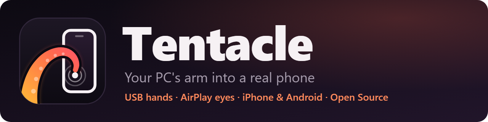
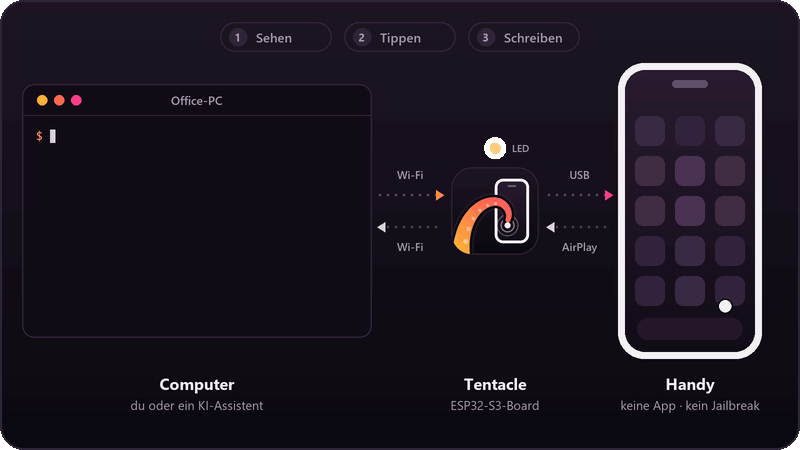
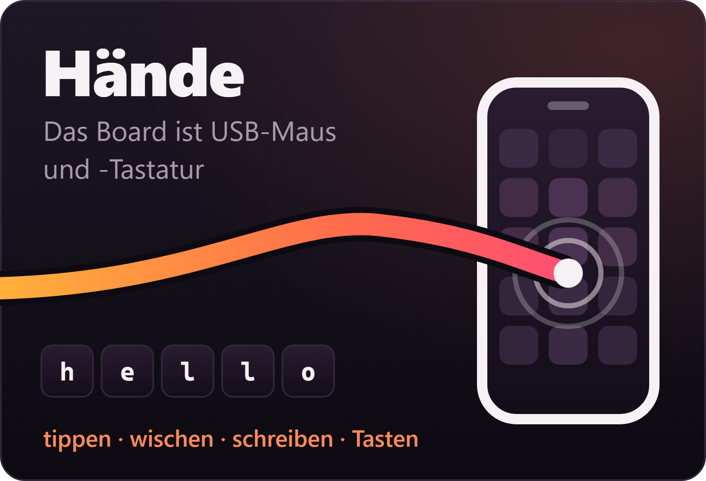
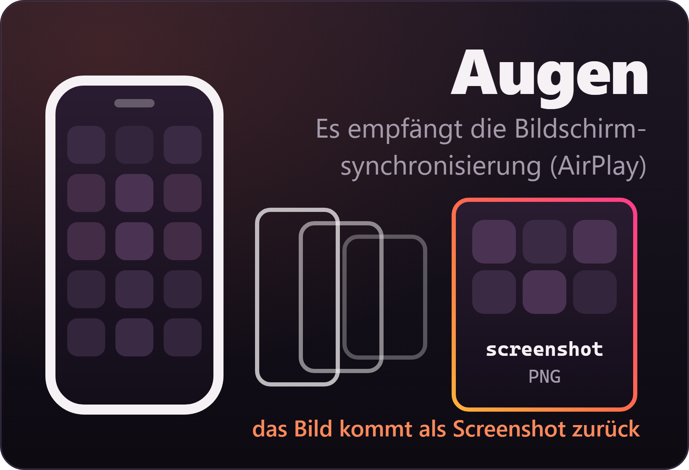
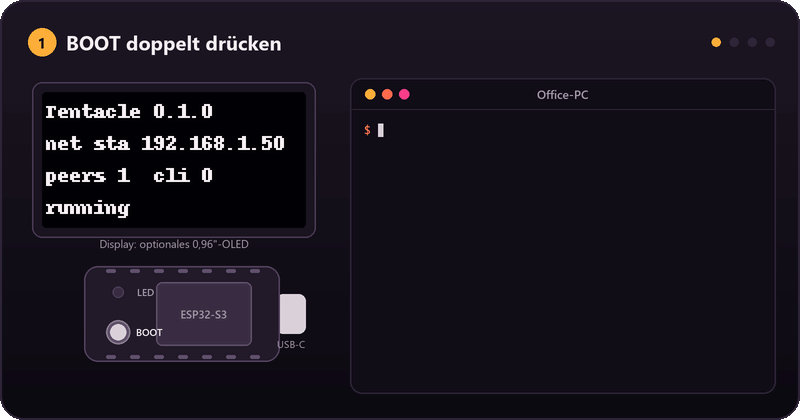
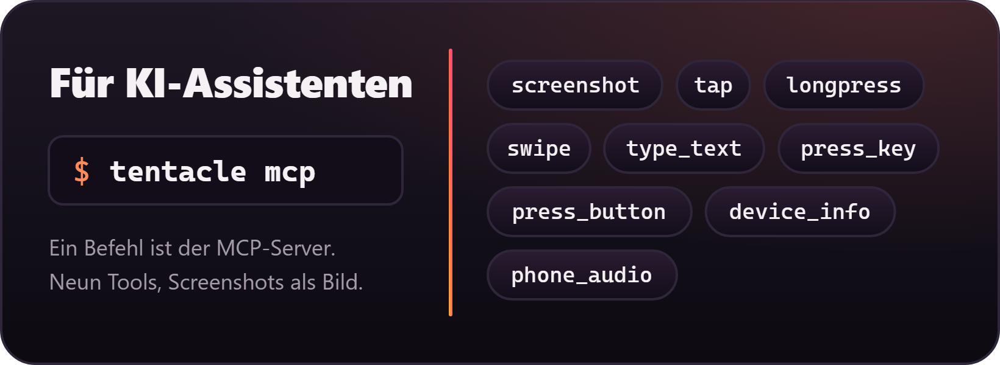
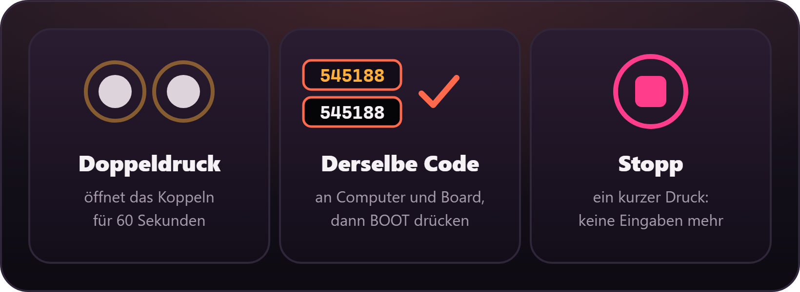
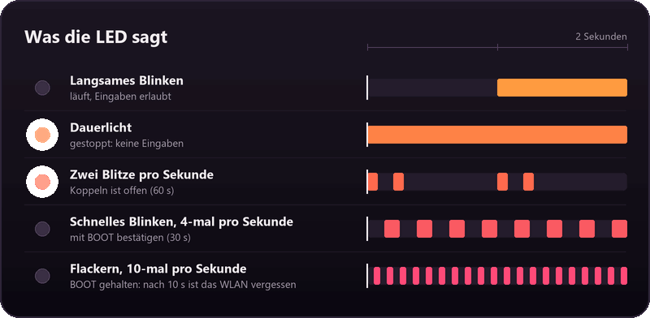
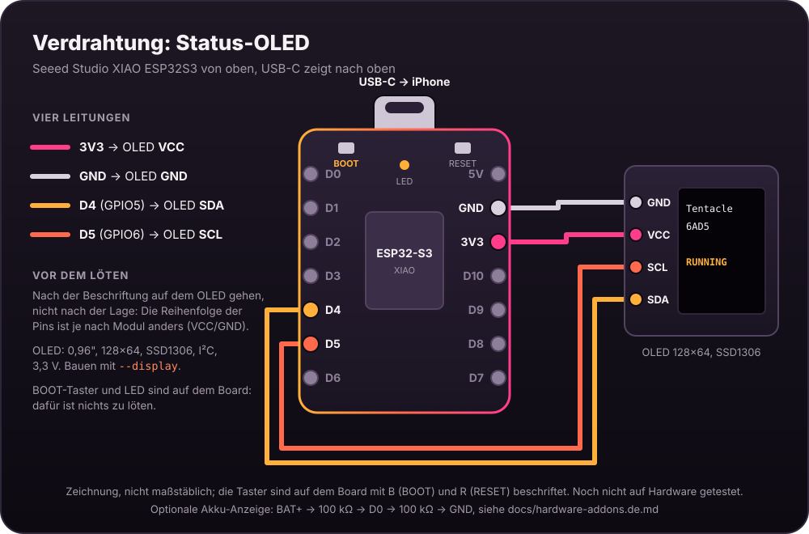
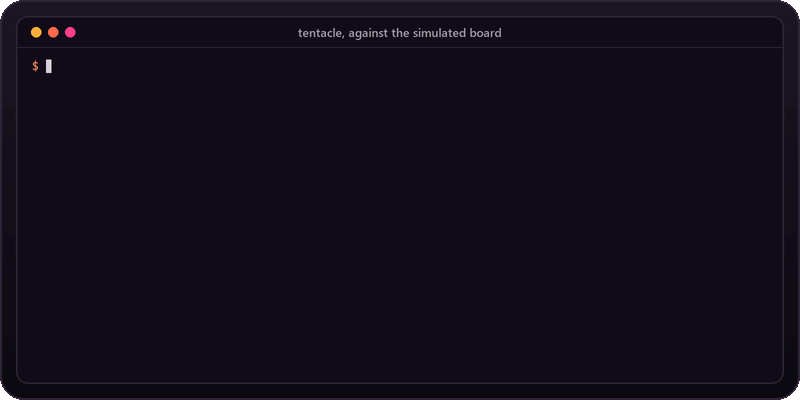

[English](README.md) | **Deutsch**

<p align="center"></p>

<p align="center">
  <b>Der Fangarm deines PCs ins echte Handy.</b><br>
  <i>Your PC's arm into a real phone.</i>
</p>

<p align="center">
  <a href="https://github.com/kewe87/phone-tentacle/actions/workflows/ci.yml"></a>
  <a href="#herkunft-und-lizenz"></a>
  
</p>

<p align="center"></p>

<sub>Die Animationen auf dieser Seite sind Illustrationen, keine Aufnahmen; das Handy ist absichtlich nur ein Schema. Echte Aufnahmen folgen nach dem ersten Hardwaretest.</sub>

> **Based on [ESP32 iPhone Agent](https://github.com/onehumanbeing/esp32-iphone-agent) by Henry Yuan (MIT).**
> Tentacle ist ein eigenes, davon abgeleitetes Projekt und weder mit ihm verbunden noch von ihm unterstützt:
> [Herkunft und Lizenz](#herkunft-und-lizenz).

> [!WARNING]
> **Noch nicht auf Hardware getestet.** Alles kompiliert und besteht seine Tests am Computer, aber noch kein Build
> ist auf einem echten Board gelaufen. Erster Hardwaretest: 17. November 2026.

## Was ist Tentacle?

Ein daumennagelgroßes ESP32-S3-Board am USB-C-Anschluss des iPhones. Dein Computer bedient darüber ein echtes Handy.

- **Hände:** Das Board ist USB-Maus und -Tastatur; mit AssistiveTouch tippt der Zeiger wie ein Finger
- **Augen:** Es empfängt die Bildschirmsynchronisierung (AirPlay) und reicht das Bild weiter
- **Vom Computer aus:** die Kommandozeile `tentacle`, für dich oder einen KI-Assistenten
- **Nur WLAN:** Der Computer findet das Board von selbst und spricht über einen verschlüsselten Port mit ihm
- **Jemand muss am Board stehen:** Einrichtung und Koppeln bestätigt die BOOT-Taste
- **Ein Stopp-Taster:** einmal kurz drücken, und das Board schickt keine Eingaben mehr

Keine App auf dem Handy, kein Jailbreak, kein Bluetooth, keine Cloud.

<p align="center">
  
  
</p>

## So funktioniert es

<p align="center"></p>

## In sechs Schritten

<p align="center"></p>

<p align="center">
  
  
</p>

<sub>Links: die Einrichtungsseite, aus dem Quelltext der Firmware gerendert. Rechts: Display-Texte und LED-Takt aus dem Quelltext der Firmware, Terminalzeilen aus einem Lauf gegen das simulierte Board (gekürzt).</sub>

## Für KI-Assistenten

- **`tentacle mcp`** ist ein MCP-Server über stdio, für jeden MCP-Client
- **Neun Tools:** sehen, tippen, wischen, schreiben, Tasten, Status
- **Screenshots kommen als Bild**, Koordinaten sind Pixel dieses Bildes

<p align="center"></p>

Einrichtung für deinen Client: [Handbuch, Kapitel 8](docs/manual.de.md#8-nutzung-mit-einem-ki-assistenten-mcp).

## Sicher gebaut

- **Koppeln nur am Board:** Ein Doppeldruck auf BOOT öffnet es für 60 Sekunden
- **Derselbe Code auf beiden Seiten:** Computer und OLED zeigen ihn, erst dann drückst du BOOT
- **Stopp geht immer:** ein kurzer Druck, und der Computer kann ihn nicht aufheben
- **Bleibt im eigenen WLAN:** ein verschlüsselter Port, kein Bluetooth, keine Cloud

<p align="center"></p>

<p align="center"></p>

Was offen bleibt, steht in [docs/hardening.de.md](docs/hardening.de.md) und [SECURITY.md](SECURITY.md).

## Was du brauchst

| | |
|---|---|
| **Board** | Seeed Studio XIAO ESP32S3 (die einfache Version, nicht Sense, nicht Plus) |
| **Kabel** | USB-C auf USB-C, ein Datenkabel |
| **Handy** | iPhone mit USB-C, iOS 18 oder neuer |
| **Display** | 0,96″-OLED (SSD1306, I²C), empfohlen: Ohne es lässt sich der Koppel-Code nicht vergleichen |
| **Computer** | Windows, macOS oder Linux im selben WLAN (2,4 GHz), mit [arduino-cli](https://arduino.github.io/arduino-cli/), [Go](https://go.dev/dl/) und `ffmpeg` |

<p align="center"></p>


## Schnellstart

```bash
git clone https://github.com/kewe87/phone-tentacle.git && cd phone-tentacle
arduino-cli core install esp32:esp32@3.3.12 && arduino-cli lib install U8g2
hardware/flash.sh --display        # zeigt das Setup-WLAN Tentacle-XXXX und sein Passwort
#   Tentacle-XXXX beitreten, auf der Seite das eigene WLAN wählen, BOOT drücken
(cd cli && go build -o tentacle ./cmd/tentacle)
#   BOOT doppelt drücken, dann:
cli/tentacle pair                  # 6-stelligen Code mit dem OLED vergleichen, BOOT drücken
#   Board ans iPhone stecken: AssistiveTouch an, Bildschirmsynchronisierung › Tentacle XXXX
cli/tentacle screenshot
```

Jeder Schritt im Einzelnen, Verdrahtung und Fehlersuche: **[das Handbuch](docs/manual.de.md)**.

<details>
<summary><b>Was die CLI antwortet</b> (Mitschnitt gegen das simulierte Board)</summary>

<p align="center"></p>

<sub>Die Ausgaben sind unverändert die eines Laufs gegen das simulierte Board (`hardware/tests/sim`); nur das Tippen ist nachgestellt.</sub>

</details>

## Roadmap

- **Erster Lauf auf Hardware**, danach Korrekturen
- **Web-Fernbedienung auf dem Board:** Live-Bild, Maus und Tastatur im Browser
- **Android:** dasselbe Board als Hände, Screenshots über ADB ([docs/android.de.md](docs/android.de.md))

Mehr: [ROADMAP.de.md](ROADMAP.de.md).

## Dokumentation

| | |
|---|---|
| **[Handbuch](docs/manual.de.md)** | Teile, Flashen, Einrichtung, Koppeln, Taste und LED, Fehlersuche, alle Befehle |
| [cli/README.md](cli/README.md) | das Innenleben der CLI (englisch) |
| [docs/hardening.de.md](docs/hardening.de.md) · [SECURITY.md](SECURITY.md) | wer was erreichen kann und was offen bleibt |
| [docs/hardware-addons.de.md](docs/hardware-addons.de.md) | OLED, Akku, Gehäuse |
| [docs/cli-protocol.md](docs/cli-protocol.md) | was über die Leitung geht (englisch) |
| [CHANGELOG.md](CHANGELOG.md) · [CONTRIBUTING.md](CONTRIBUTING.md) | englisch |

## Herkunft und Lizenz

**Based on [ESP32 iPhone Agent](https://github.com/onehumanbeing/esp32-iphone-agent) by Henry Yuan**
(MIT, Copyright © 2026 Henry Yuan). Die Idee, die AirPlay-Portierung, die USB-Seite und die Kommandozeile stammen
aus seinem Projekt. Sein Urheberrechts- und Erlaubnisvermerk steht unverändert in [LICENSE](LICENSE) und
[NOTICE](NOTICE). Tentacle hat die iPhone-App, Bluetooth und Updates über Funk entfernt und die reine
WLAN-Verbindung, das Setup-WLAN, das Koppeln per Taste, den Stopp-Taster und das Display ergänzt.

- **MIT** ([LICENSE](LICENSE)) für alles außer dem Verzeichnis unten. Tentacles eigene Änderungen: Copyright ©
  2026 kewe87, zu denselben Bedingungen (siehe [NOTICE](NOTICE)).
- **GPL-3.0** für `hardware/hid_bridge/src/airplay/`, den aus [UxPlay](https://github.com/FDH2/UxPlay) portierten
  AirPlay-Empfänger ([LICENSE-GPL.md](hardware/hid_bridge/src/airplay/LICENSE-GPL.md)). Jede Firmware-Datei
  enthält dieses Verzeichnis, deshalb steht **eine Firmware-Binärdatei als Ganzes unter GPL-3.0**: Wer eine
  weitergibt (als Download oder auf einem fertig geflashten Board), muss den vollständigen passenden Quellcode
  unter GPL-3.0 anbieten und die Lizenzhinweise mitgeben. Die CLI `tentacle` enthält diesen Code nicht und
  bleibt MIT.
- Dateien unter [`skills/`](skills/) stehen unter [MIT-0](skills/LICENSE).
- Baut auf: [UxPlay](https://github.com/FDH2/UxPlay) ·
  [Arduino ESP32 core](https://github.com/espressif/arduino-esp32) · [TinyUSB](https://github.com/hathach/tinyusb) ·
  [U8g2](https://github.com/olikraus/u8g2).

**Wer auf Tentacle aufbaut:** `LICENSE` und `NOTICE` behalten und das Original sichtbar nennen, im README und in
öffentlichen Demos, Videos und Beiträgen:

> Based on ESP32 iPhone Agent by Henry Yuan — https://github.com/onehumanbeing/esp32-iphone-agent

<sub>Nur Geräte und Konten automatisieren, die dir gehören oder die du benutzen darfst. Apple, iPhone und AirPlay sind Marken von Apple Inc. Tentacle ist kein Apple-Produkt und steht in keiner Verbindung zu Apple. Der Name hat nichts mit dem gleichnamigen Deployment-Agenten von Octopus Deploy zu tun.</sub>
