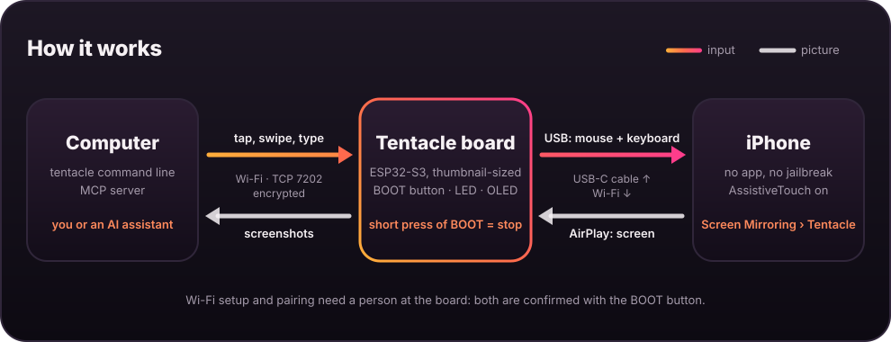
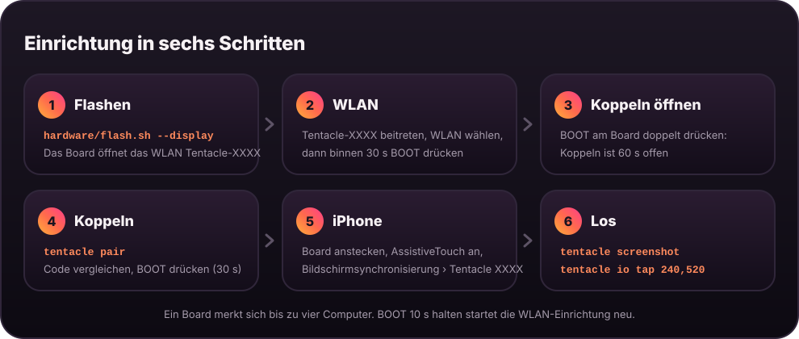
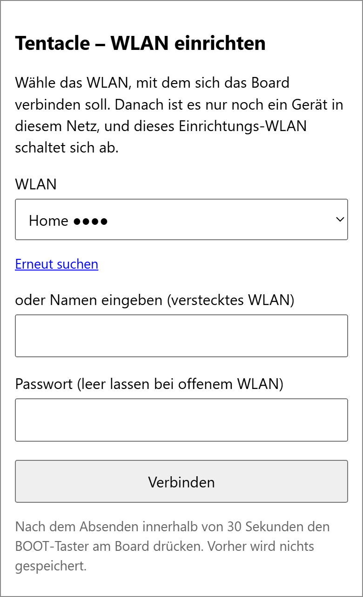
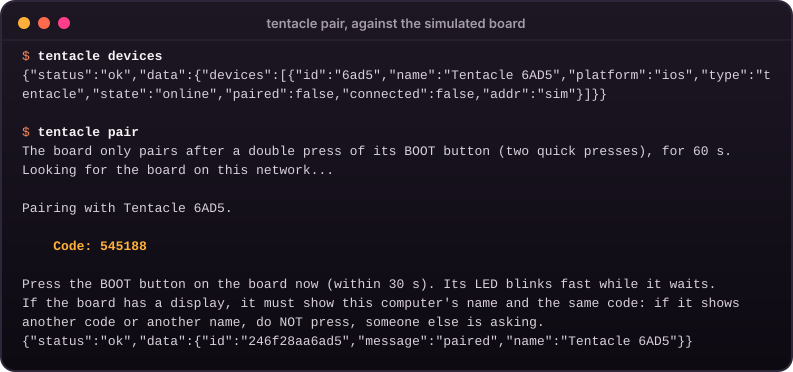

[English](README.md) | **Deutsch**

<p align="center">
  <picture>
    <source media="(prefers-color-scheme: dark)" srcset="docs/brand/logo-wordmark-dark.png">
    
  </picture>
</p>

<p align="center">
  <b>Der Fangarm deines PCs ins echte Handy.</b><br>
  Ein daumennagelgroßes ESP32-S3-Board am USB-C-Anschluss des iPhones: Maus und Tastatur als Hände, ein AirPlay-Empfänger als Augen, gesteuert vom Computer über WLAN.
</p>

<p align="center">
  <a href="https://github.com/kewe87/phone-tentacle/actions/workflows/ci.yml"></a>
  <a href="#herkunft-und-lizenz"></a>
  
</p>

> **Basiert auf [ESP32 iPhone Agent](https://github.com/onehumanbeing/esp32-iphone-agent) von Henry Yuan (MIT).**
> Tentacle ist ein eigenes, davon abgeleitetes Projekt und weder mit ihm verbunden noch von ihm unterstützt:
> [Herkunft und Lizenz](#herkunft-und-lizenz).

> [!WARNING]
> **Noch nicht auf Hardware getestet.** Alles kompiliert und besteht seine Tests am Computer (Host-Tests, ein
> simuliertes Board, die Tests der CLI), aber noch kein Build ist auf einem echten Board gelaufen. Erster
> Hardware-Test: 17. November 2026. Solange dieser Hinweis hier steht, kann einiges nicht funktionieren.

<p align="center"></p>

## Was es kann

- **Hände:** Das Board ist USB-Maus und -Tastatur; mit AssistiveTouch tippt der Zeiger wie ein Finger
- **Augen:** Das Board empfängt die Bildschirmsynchronisierung (AirPlay) des Handys und reicht das Bild weiter
- **Vom Computer aus:** die Kommandozeile `tentacle`, die zugleich MCP-Server für KI-Assistenten ist
- **Nur WLAN:** Der Computer findet das Board von selbst (mDNS) und spricht über einen verschlüsselten Port mit ihm
- **Jemand muss am Board stehen:** WLAN-Einrichtung und Koppeln werden mit der BOOT-Taste bestätigt
- **Ein Stopp-Taster:** einmal kurz BOOT drücken, und das Board schickt keine Eingaben mehr

Keine App auf dem Handy, kein Jailbreak, kein Bluetooth, keine Cloud.

## Schnellstart

Du brauchst ein Seeed Studio XIAO ESP32S3, ein USB-C-Datenkabel, ein iPhone mit USB-C und am Computer
[arduino-cli](https://arduino.github.io/arduino-cli/), [Go](https://go.dev/dl/) und `ffmpeg`. Ein kleines OLED
ist empfohlen. Teile, Verdrahtung und jeder Schritt im Einzelnen: **[das Handbuch](docs/manual.de.md)**.

```bash
git clone https://github.com/kewe87/phone-tentacle.git && cd phone-tentacle
arduino-cli core install esp32:esp32@3.3.12 && arduino-cli lib install U8g2
hardware/flash.sh --display        # zeigt das Setup-WLAN Tentacle-XXXX und sein Passwort
#   Tentacle-XXXX beitreten, auf der Seite das eigene WLAN wählen, BOOT drücken
(cd cli && go build -o tentacle ./cmd/tentacle)
#   BOOT doppelt drücken, dann:
cli/tentacle pair                  # 6-stelligen Code mit dem OLED vergleichen, BOOT drücken
#   Board ans iPhone stecken: AssistiveTouch an, Bildschirmsynchronisierung › Tentacle XXXX
cli/tentacle screenshot
```

<p align="center"></p>

<p align="center">
  <picture>
    <source media="(prefers-color-scheme: dark)" srcset="docs/images/setup-page-de-dark.png">
    
  </picture>
  
</p>

<sub>Links: Einrichtungsseite, aus dem Quelltext der Firmware gerendert. Rechts: Ausgabe gegen das simulierte
Board. Fotos folgen nach dem ersten Hardwaretest.</sub>

## Dokumentation

- **[Handbuch](docs/manual.de.md)** — Teile, Flashen, Einrichtung, Koppeln, Taste und LED, Fehlersuche, alle Befehle
- [cli/README.md](cli/README.md) — das Innenleben der CLI: Daemon, Verlauf, Intents, Gedächtnis, Entwicklung (englisch)
- [docs/hardening.de.md](docs/hardening.de.md) — wer was erreichen kann und was offen bleibt · [SECURITY.md](SECURITY.md)
- [docs/hardware-addons.de.md](docs/hardware-addons.de.md) — OLED, Akku, Gehäuse
- [docs/cli-protocol.md](docs/cli-protocol.md) — was über die Leitung geht (englisch)
- [CHANGELOG.md](CHANGELOG.md) · [CONTRIBUTING.md](CONTRIBUTING.md) (englisch)

## Roadmap

- Erster Lauf auf Hardware, danach Korrekturen
- **Web-Fernbedienung auf dem Board:** Live-Bild, Maus und Tastatur im Browser, nichts am Computer zu installieren
- **Android:** dasselbe Board als Hände, Screenshots über ADB ([docs/android.de.md](docs/android.de.md))

Mehr: [ROADMAP.de.md](ROADMAP.de.md).

## Herkunft und Lizenz

**Basiert auf [ESP32 iPhone Agent](https://github.com/onehumanbeing/esp32-iphone-agent) von Henry Yuan**
(MIT, Copyright © 2026 Henry Yuan) — *Based on ESP32 iPhone Agent by Henry Yuan*. Die Idee, die
AirPlay-Portierung, die USB-Seite und die Kommandozeile stammen aus seinem Projekt. Sein Urheberrechts- und
Erlaubnisvermerk steht unverändert in [LICENSE](LICENSE) und [NOTICE](NOTICE). Tentacle hat aus diesem Code die
iPhone-App, Bluetooth und Updates über Funk entfernt und die reine WLAN-Verbindung, das Setup-WLAN, das Koppeln
per Taste, den Stopp-Taster und das Display ergänzt.

- **MIT** ([LICENSE](LICENSE)) für alles außer dem Verzeichnis unten. Tentacles eigene Änderungen: Copyright ©
  2026 kewe87, zu denselben Bedingungen (siehe [NOTICE](NOTICE)).
- **GPL-3.0** für `hardware/hid_bridge/src/airplay/`, den aus [UxPlay](https://github.com/FDH2/UxPlay) portierten
  AirPlay-Empfänger ([LICENSE-GPL.md](hardware/hid_bridge/src/airplay/LICENSE-GPL.md)). Jede Firmware-Datei
  enthält dieses Verzeichnis, deshalb steht **eine Firmware-Binärdatei als Ganzes unter GPL-3.0**: Wer eine
  weitergibt (als Download oder auf einem fertig geflashten Board), muss den vollständigen passenden Quellcode
  unter GPL-3.0 anbieten und die Lizenzhinweise mitgeben. Die CLI `tentacle` enthält diesen Code nicht und
  bleibt MIT.
- Dateien unter [`skills/`](skills/) stehen unter [MIT-0](skills/LICENSE).
- Baut auf: [UxPlay](https://github.com/FDH2/UxPlay) ·
  [Arduino ESP32 core](https://github.com/espressif/arduino-esp32) · [TinyUSB](https://github.com/hathach/tinyusb) ·
  [U8g2](https://github.com/olikraus/u8g2).

**Wer auf Tentacle aufbaut:** `LICENSE` und `NOTICE` behalten und das Original sichtbar nennen, im README und in
öffentlichen Demos, Videos und Beiträgen:

> Based on ESP32 iPhone Agent by Henry Yuan — https://github.com/onehumanbeing/esp32-iphone-agent

Nur Geräte und Konten automatisieren, die dir gehören oder die du benutzen darfst. Apple, iPhone und AirPlay
sind Marken von Apple Inc. Tentacle ist kein Apple-Produkt und steht in keiner Verbindung zu Apple. Der Name hat
nichts mit dem gleichnamigen Deployment-Agenten von Octopus Deploy zu tun.
