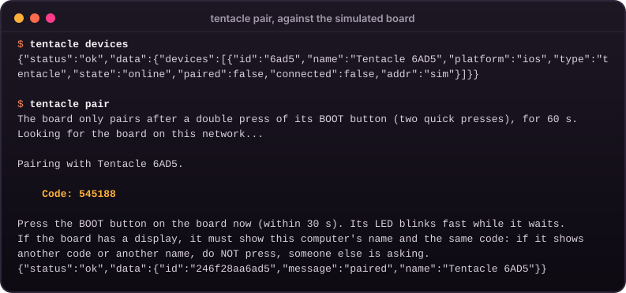

**English** | [Deutsch](README.de.md)

<p align="center">
  <picture>
    <source media="(prefers-color-scheme: dark)" srcset="docs/brand/logo-wordmark-dark.png">
    
  </picture>
</p>

<p align="center">
  <b>Your PC's arm into a real phone.</b><br>
  A thumbnail-sized ESP32-S3 board on the iPhone's USB-C port: mouse and keyboard for the hands, an AirPlay receiver for the eyes, driven from your computer over Wi-Fi.
</p>

<p align="center">
  <a href="https://github.com/kewe87/phone-tentacle/actions/workflows/ci.yml"></a>
  <a href="#origin-and-license"></a>
  
</p>

> **Based on [ESP32 iPhone Agent](https://github.com/onehumanbeing/esp32-iphone-agent) by Henry Yuan (MIT).**
> Tentacle is a separate project derived from it, not affiliated with or endorsed by it:
> [Origin and license](#origin-and-license).

> [!WARNING]
> **Not yet tested on hardware.** Everything compiles and passes its tests on the computer (host tests, a
> simulated board, the CLI's tests), but no build has run on a real board yet. First hardware test: 17 November
> 2026. Until this note is gone, expect things that do not work.

<p align="center"></p>

## What it does

- **Hands:** the board is a USB mouse and keyboard; with AssistiveTouch the pointer taps like a finger
- **Eyes:** the board receives the phone's Screen Mirroring (AirPlay) and passes the picture on
- **From the computer:** the `tentacle` command line, which is also an MCP server for AI assistants
- **Wi-Fi only:** the computer finds the board by itself (mDNS) and talks to it on one encrypted port
- **Someone has to be at the board:** Wi-Fi setup and pairing are confirmed with its BOOT button
- **A stop button:** one short press of BOOT and the board sends no more input

No app on the phone, no jailbreak, no Bluetooth, no cloud.

## Quick start

You need a Seeed Studio XIAO ESP32S3, a USB-C data cable, an iPhone with USB-C, and
[arduino-cli](https://arduino.github.io/arduino-cli/), [Go](https://go.dev/dl/) and `ffmpeg` on the computer.
A small OLED is recommended. Parts, wiring and every step in detail: **[the manual](docs/manual.md)**.

```bash
git clone https://github.com/kewe87/phone-tentacle.git && cd phone-tentacle
arduino-cli core install esp32:esp32@3.3.12 && arduino-cli lib install U8g2
hardware/flash.sh --display        # prints the setup Wi-Fi Tentacle-XXXX and its password
#   join Tentacle-XXXX, choose your Wi-Fi on the page that opens, press BOOT
(cd cli && go build -o tentacle ./cmd/tentacle)
#   double-press BOOT, then:
cli/tentacle pair                  # compare the 6-digit code with the OLED, press BOOT
#   plug the board into the iPhone: AssistiveTouch on, Screen Mirroring › Tentacle XXXX
cli/tentacle screenshot
```

<p align="center"></p>

<p align="center">
  <picture>
    <source media="(prefers-color-scheme: dark)" srcset="docs/images/setup-page-en-dark.png">
    
  </picture>
  
</p>

<sub>Left: the setup page, rendered from the firmware's source code. Right: output against the simulated board.
Photos follow after the first hardware test.</sub>

## Documentation

- **[Manual](docs/manual.md)** — parts, flashing, setup, pairing, button and LED, troubleshooting, all commands
- [cli/README.md](cli/README.md) — how the CLI works inside: daemon, history, intents, memory, development
- [docs/hardening.md](docs/hardening.md) — who can reach what, and what is left open · [SECURITY.md](SECURITY.md)
- [docs/hardware-addons.md](docs/hardware-addons.md) — OLED, battery, case
- [docs/cli-protocol.md](docs/cli-protocol.md) — what goes over the wire
- [CHANGELOG.md](CHANGELOG.md) · [CONTRIBUTING.md](CONTRIBUTING.md)

## Roadmap

- First run on hardware, then fixes
- **Web remote on the board:** live picture, mouse and keyboard in the browser, nothing to install on the computer
- **Android:** the same board as the hands, screenshots over ADB ([docs/android.md](docs/android.md))

More: [ROADMAP.md](ROADMAP.md).

## Origin and license

**Based on [ESP32 iPhone Agent](https://github.com/onehumanbeing/esp32-iphone-agent) by Henry Yuan**
(MIT, Copyright © 2026 Henry Yuan). The idea, the AirPlay port, the USB side and the command line come from his
project. His copyright and permission notice stay unchanged in [LICENSE](LICENSE) and [NOTICE](NOTICE). Tentacle
removed the iPhone app, Bluetooth and over-the-air updates from that code and added the Wi-Fi-only link, the
setup hotspot, pairing with the button, the stop button and the display.

- **MIT** ([LICENSE](LICENSE)) for everything except the directory below. Tentacle's own changes: Copyright ©
  2026 kewe87, under the same terms (see [NOTICE](NOTICE)).
- **GPL-3.0** for `hardware/hid_bridge/src/airplay/`, the AirPlay receiver ported from
  [UxPlay](https://github.com/FDH2/UxPlay) ([LICENSE-GPL.md](hardware/hid_bridge/src/airplay/LICENSE-GPL.md)).
  Every firmware binary links that directory, so **a firmware binary as a whole is GPL-3.0**: if you pass one
  on (a download, a pre-flashed board), you have to offer the complete matching source code under GPL-3.0 and
  keep the license notices with it. The `tentacle` CLI does not contain that code and stays MIT.
- Files under [`skills/`](skills/) are [MIT-0](skills/LICENSE).
- Built on: [UxPlay](https://github.com/FDH2/UxPlay) ·
  [Arduino ESP32 core](https://github.com/espressif/arduino-esp32) · [TinyUSB](https://github.com/hathach/tinyusb) ·
  [U8g2](https://github.com/olikraus/u8g2).

**If you build on Tentacle:** keep `LICENSE` and `NOTICE`, and credit the original visibly, in your README and
in public demos, videos and posts:

> Based on ESP32 iPhone Agent by Henry Yuan — https://github.com/onehumanbeing/esp32-iphone-agent

Only automate devices and accounts that are yours or that you are allowed to use. Apple, iPhone and AirPlay are
trademarks of Apple Inc. Tentacle is not an Apple product and is not connected to Apple. The name has nothing to
do with the deployment agent of the same name by Octopus Deploy.
