**English** | [Deutsch](README.de.md)

<p align="center">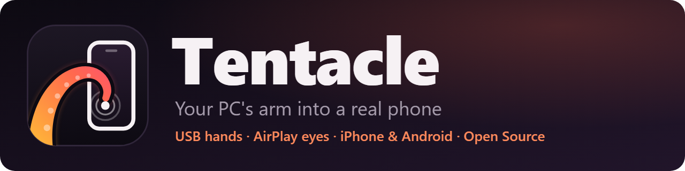</p>

<p align="center">
  <b>Your PC's arm into a real phone.</b><br>
  <i>USB hands, AirPlay eyes, Wi-Fi only.</i>
</p>

<p align="center">
  <a href="https://github.com/kewe87/phone-tentacle/actions/workflows/ci.yml"></a>
  <a href="#origin-and-license"></a>
  
</p>

<p align="center">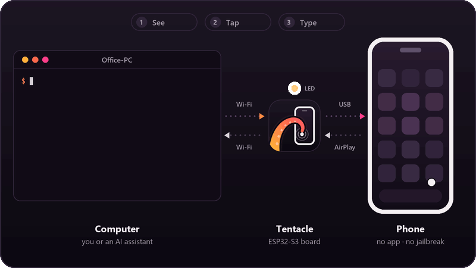</p>

<sub>The animations on this page are illustrations, not recordings; the phone is a schematic on purpose. Real recordings follow after the first hardware test.</sub>

> **Based on [ESP32 iPhone Agent](https://github.com/onehumanbeing/esp32-iphone-agent) by Henry Yuan (MIT).**
> Tentacle is a separate project derived from it, not affiliated with or endorsed by it:
> [Origin and license](#origin-and-license).

> [!WARNING]
> **Not yet tested on hardware.** Everything compiles and passes its tests on the computer, but no build has run
> on a real board yet. First hardware test: 17 November 2026.

## What is Tentacle?

A thumbnail-sized ESP32-S3 board on the iPhone's USB-C port. Your computer drives a real phone through it.

- **Hands:** the board is a USB mouse and keyboard; with AssistiveTouch the pointer taps like a finger
- **Eyes:** it receives the phone's Screen Mirroring (AirPlay) and passes the picture on
- **From the computer:** the `tentacle` command line, for you or an AI assistant
- **From the browser:** the board's own web page shows the phone live and takes mouse and keyboard
- **Wi-Fi only:** the computer finds the board by itself and talks to it on one encrypted port
- **Someone has to be at the board:** setup and pairing are confirmed with its BOOT button
- **A stop button:** one short press, and the board sends no more input

No app on the phone, no jailbreak, no Bluetooth, no cloud.

<p align="center">
  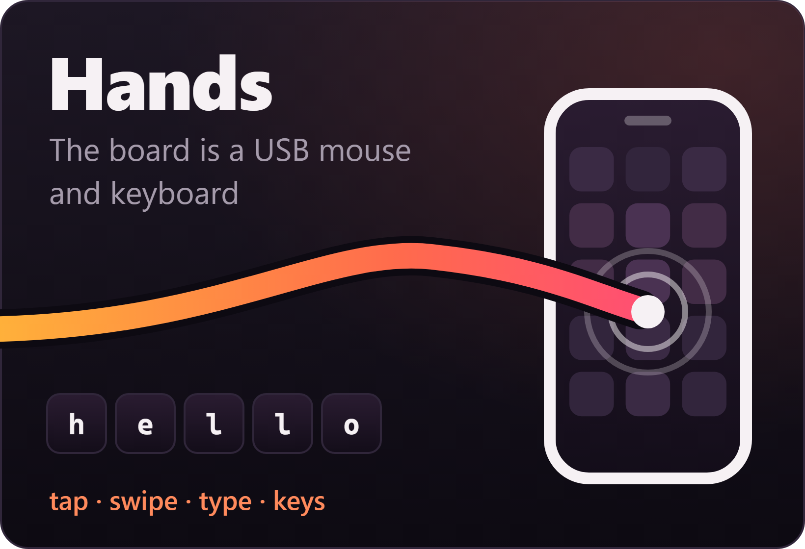
  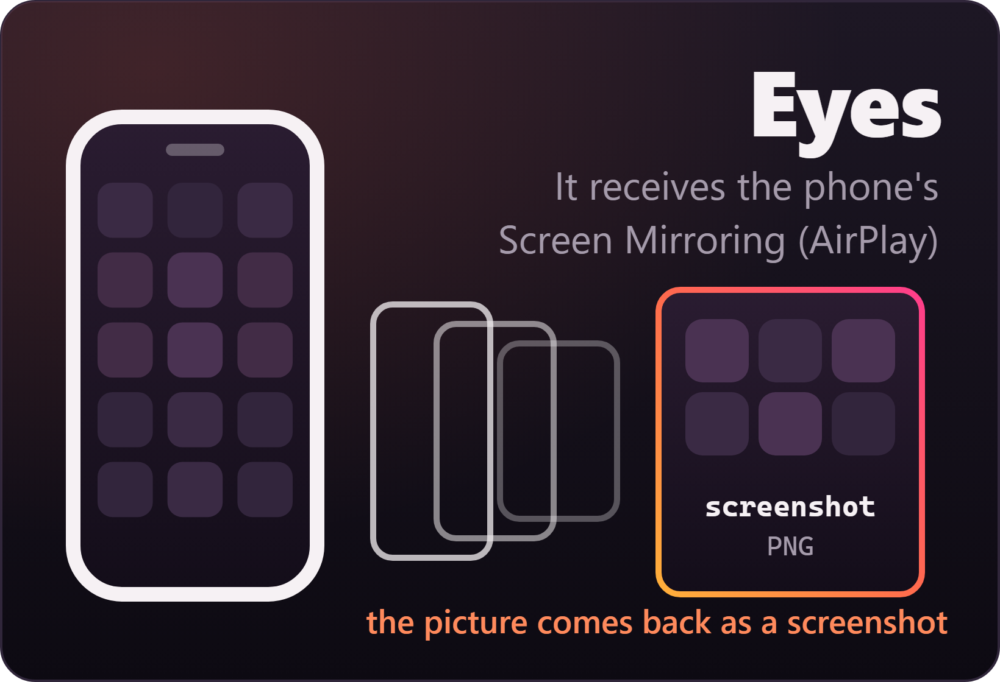
</p>

## How it works

<p align="center">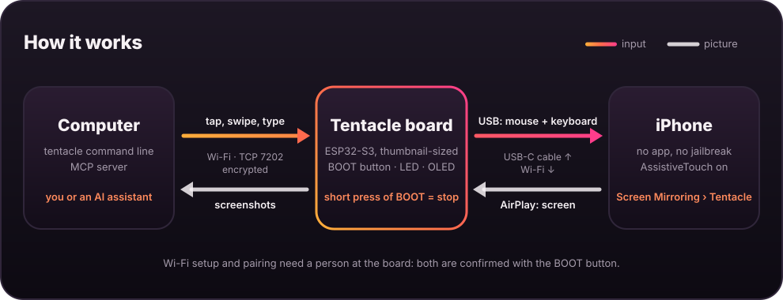</p>

## In six steps

<p align="center">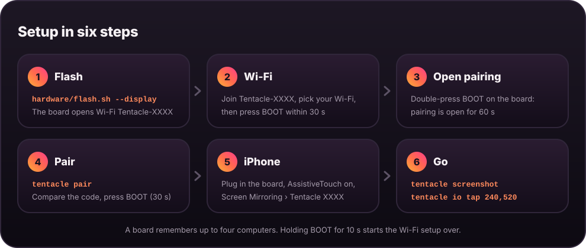</p>

<p align="center">
  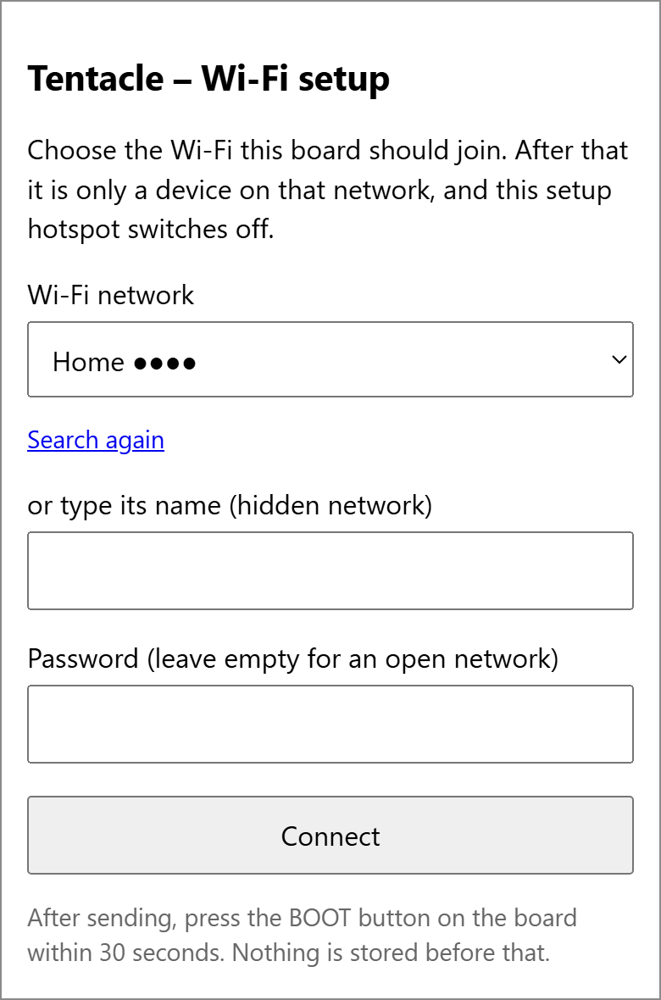
  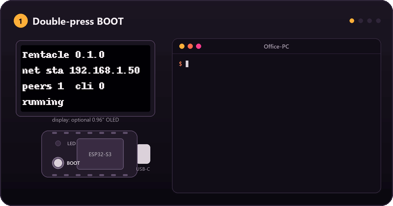
</p>

<sub>Left: the setup page, rendered from the firmware's source code. Right: display texts and LED timing from the firmware's source code, terminal lines from a run against the simulated board (shortened).</sub>

## For AI assistants

- **`tentacle mcp`** is an MCP server on stdio, for any MCP client
- **Nine tools:** see, tap, swipe, type, keys, status
- **Screenshots arrive as images**, coordinates are pixels of that image

<p align="center">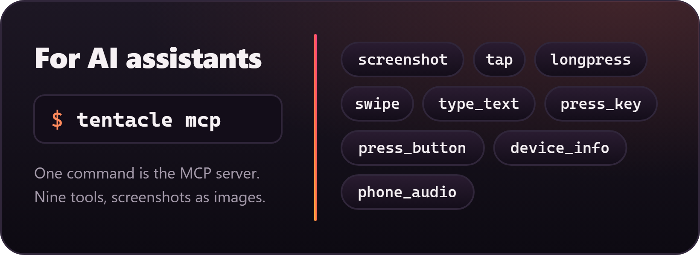</p>

Setup for your client: [manual, chapter 8](docs/manual.md#8-use-it-with-an-ai-assistant-mcp).

## Built to be safe

- **Pairing only at the board:** a double press of BOOT opens it for 60 seconds
- **The same code on both sides:** the computer and the OLED show it, only then you press BOOT
- **Stop always works:** one short press, and the computer cannot undo it
- **Stays on your Wi-Fi:** one encrypted port, no Bluetooth, no cloud

<p align="center">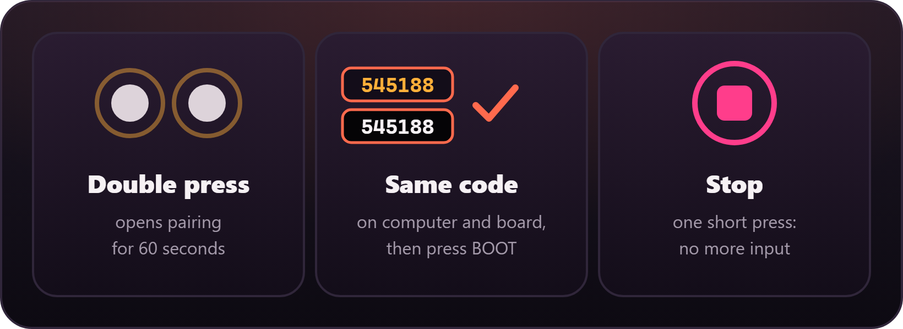</p>

<p align="center">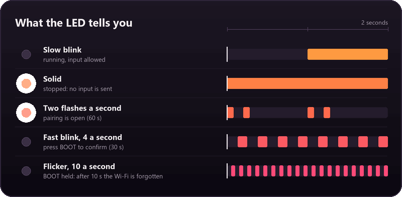</p>

What is left open: [docs/hardening.md](docs/hardening.md) and [SECURITY.md](SECURITY.md).

## What you need

| | |
|---|---|
| **Board** | Seeed Studio XIAO ESP32S3 (the plain version, not Sense, not Plus) |
| **Cable** | USB-C to USB-C, a data cable |
| **Phone** | iPhone with USB-C, iOS 18 or later |
| **Display** | 0.96″ OLED (SSD1306, I²C), recommended: without it the pairing code cannot be compared |
| **Computer** | Windows, macOS or Linux on the same Wi-Fi (2.4 GHz), with [arduino-cli](https://arduino.github.io/arduino-cli/), [Go](https://go.dev/dl/) and `ffmpeg` |

<p align="center">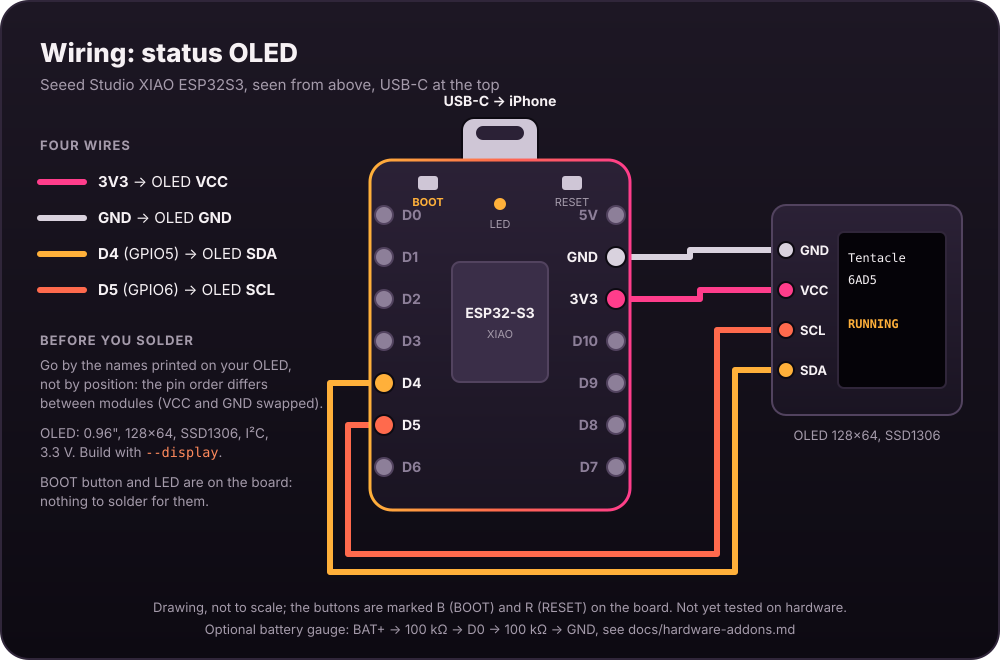</p>


## Quick start

```bash
git clone https://github.com/kewe87/phone-tentacle.git && cd phone-tentacle
arduino-cli core install esp32:esp32@3.3.12 && arduino-cli lib install U8g2
hardware/flash.sh --display        # prints the setup Wi-Fi Tentacle-XXXX and its password
#   join Tentacle-XXXX, choose your Wi-Fi on the page that opens, press BOOT
(cd cli && go build -o tentacle ./cmd/tentacle)
#   double-press BOOT, then:
cli/tentacle pair                  # compare the 6-digit code with the OLED, press BOOT
#   plug the board into the iPhone: AssistiveTouch on, Screen Mirroring › Tentacle XXXX
cli/tentacle screenshot
```

**Without arduino-cli:** `tentacle-flash` installs the firmware with a double click on Windows, macOS and Linux,
with nothing else to install. It finds the board, writes and checks the firmware and shows the setup Wi-Fi as a
QR code ([the manual, "Flashing the easy way"](docs/manual.md#flashing-the-easy-way-tentacle-flash)).

Every step in detail, wiring and troubleshooting: **[the manual](docs/manual.md)**.

<details>
<summary><b>What the CLI answers</b> (recorded against the simulated board)</summary>

<p align="center">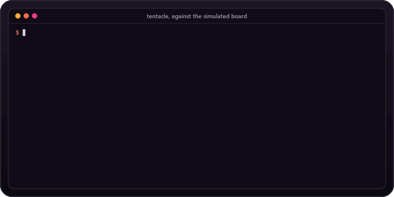</p>

<sub>The output is unchanged from a run against the simulated board (`hardware/tests/sim`); only the typing is staged.</sub>

</details>

## Roadmap

- **First run on hardware**, then fixes
- **Android:** the same board as the hands, screenshots over ADB ([docs/android.md](docs/android.md))

More: [ROADMAP.md](ROADMAP.md).

## Documentation

| | |
|---|---|
| **[Manual](docs/manual.md)** | parts, flashing, setup, pairing, button and LED, troubleshooting, all commands |
| [cli/README.md](cli/README.md) | how the CLI works inside |
| [docs/hardening.md](docs/hardening.md) · [SECURITY.md](SECURITY.md) | who can reach what, and what is left open |
| [docs/hardware-addons.md](docs/hardware-addons.md) | OLED, battery, case |
| [docs/cli-protocol.md](docs/cli-protocol.md) | what goes over the wire |
| [CHANGELOG.md](CHANGELOG.md) · [CONTRIBUTING.md](CONTRIBUTING.md) | changes, how to contribute |

## Origin and license

**Based on [ESP32 iPhone Agent](https://github.com/onehumanbeing/esp32-iphone-agent) by Henry Yuan**
(MIT, Copyright © 2026 Henry Yuan). The idea, the AirPlay port, the USB side and the command line come from his
project. His copyright and permission notice stay unchanged in [LICENSE](LICENSE) and [NOTICE](NOTICE). Tentacle
removed the iPhone app, Bluetooth and over-the-air updates from that code and added the Wi-Fi-only link, the
setup hotspot, pairing with the button, the stop button and the display.

- **MIT** ([LICENSE](LICENSE)) for everything except the directory below. Tentacle's own changes: Copyright ©
  2026 kewe87, under the same terms (see [NOTICE](NOTICE)).
- **GPL-3.0** for `hardware/hid_bridge/src/airplay/`, the AirPlay receiver ported from
  [UxPlay](https://github.com/FDH2/UxPlay) ([LICENSE-GPL.md](hardware/hid_bridge/src/airplay/LICENSE-GPL.md)).
  Every firmware binary links that directory, so **a firmware binary as a whole is GPL-3.0**: if you pass one
  on (a download, a pre-flashed board), you have to offer the complete matching source code under GPL-3.0 and
  keep the license notices with it. The `tentacle` CLI does not contain that code and stays MIT.
- Files under [`skills/`](skills/) are [MIT-0](skills/LICENSE).
- Built on: [UxPlay](https://github.com/FDH2/UxPlay) ·
  [Arduino ESP32 core](https://github.com/espressif/arduino-esp32) · [TinyUSB](https://github.com/hathach/tinyusb) ·
  [U8g2](https://github.com/olikraus/u8g2).

**If you build on Tentacle:** keep `LICENSE` and `NOTICE`, and credit the original visibly, in your README and
in public demos, videos and posts:

> Based on ESP32 iPhone Agent by Henry Yuan — https://github.com/onehumanbeing/esp32-iphone-agent

<sub>Only automate devices and accounts that are yours or that you are allowed to use. Apple, iPhone and AirPlay are trademarks of Apple Inc. Tentacle is not an Apple product and is not connected to Apple. The name has nothing to do with the deployment agent of the same name by Octopus Deploy.</sub>
