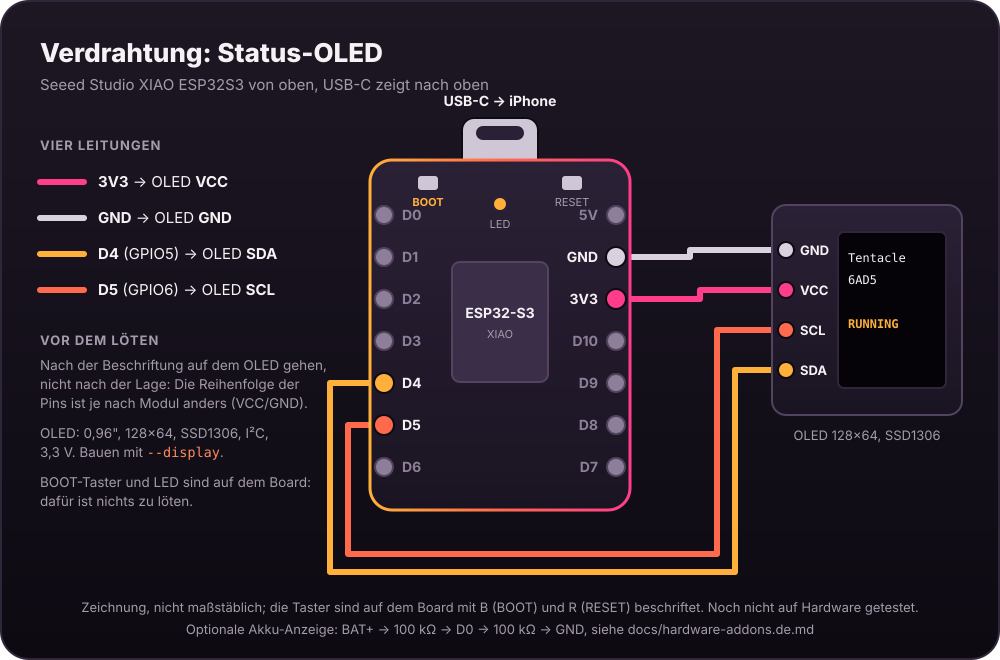
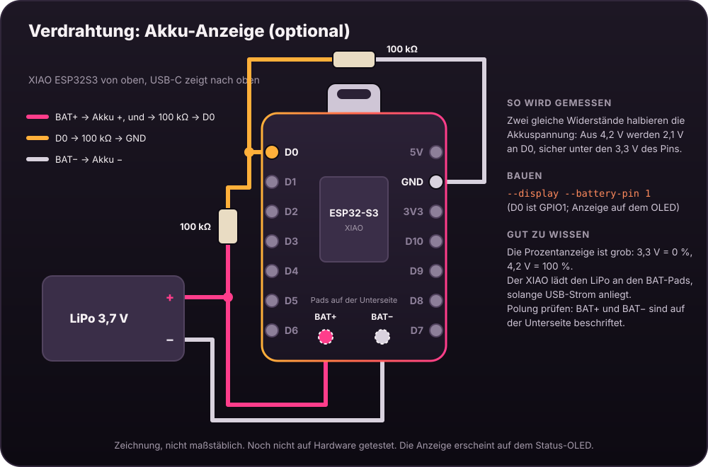

# Optionale Hardware-Erweiterungen

[English](hardware-addons.md) · **Deutsch**

Jedes Extra muss angeschlossen sein. Die Firmware-Unterstützung steckt in jedem Image (0.4.0): das OLED findet
das Board selbst, der Akku-Pin ist eine Einstellung (`tentacle device set`, oder Einstellungen › Hardware in der
Weboberfläche; siehe [Handbuch](manual.de.md#board-einstellungen)). Noch nicht auf Hardware getestet. (Der Stopp-Taster braucht keine Teile und ist
standardmäßig an; siehe [hardening.de.md](hardening.de.md).)

## Status-OLED (128×64 SSD1306, I²C) — Einstellung `display`
Ein 0,96″-SSD1306-OLED (wenige Euro) zeigt Board-Name + Firmware, Netzwerkmodus + IP, Anzahl der Verbindungen
und **läuft / GESTOPPT** (gekoppelt an den BOOT-Stopp-Taster). Außerdem zeigt es, was man am Board braucht: Name
und Passwort des Setup-WLANs, `KOPPELN OFFEN` nach einem Doppeldruck auf BOOT und den **Koppel-Code** mit dem
Namen des Computers, solange eine Anfrage auf die Taste wartet. **Empfohlen:** Ohne OLED lässt sich der Code nicht
vergleichen.

Anschluss (die I²C-Pins des XIAO ESP32-S3; die Firmware nimmt GPIO5/GPIO6 auf jedem Board):

| OLED | XIAO |
|------|------|
| VCC  | 3V3  |
| GND  | GND  |
| SDA  | D4 (GPIO5) |
| SCL  | D5 (GPIO6) |

Beim Start fragt die Firmware die Adressen 0x3C und 0x3D an diesen Pins ab; antwortet eine, wird die Anzeige
benutzt. Nichts zu bauen oder einzustellen: `display auto` ist der Standard. `display on` zeichnet auch ohne
Antwort (ein Modul, das nicht quittiert), `display off` lässt die Pins in Ruhe. Die Texte sind deutsch oder
englisch (Einstellung `lang`).

## Akku-Anzeige (LiPo) — Einstellung `battery`
Misst die Akkuspannung über einen Spannungsteiler an einem Analog-Pin und zeigt grob die Prozent auf dem OLED.

- Verdrahten: `BAT+ → 100 kΩ → D0 (GPIO1) → 100 kΩ → GND` (zwei gleiche Widerstände = Teiler 2:1; hält den
  Pin unter 3,3 V).
- Pin einstellen: `tentacle device set battery 1` (GPIO1-4 oder 7-10; 5 und 6 gehören dem OLED). Bei anderem
  Teilerverhältnis: `tentacle device set battery_div 3.00` (Akku-Volt je Pin-Volt; Standard 2.00).
- Der volle Status (`tentacle device info`) enthält den Ladestand auch als `bat`.
- Die Prozentkurve ist grob 3,3 V = 0 % … 4,2 V = 100 %; für den eigenen Akku kalibrieren.
- Der XIAO ESP32-S3 lädt einen LiPo an seinen BAT-Pads, so laufen Board + Handy auch unterwegs.

## Gehäuse
Auf Etsy/Printables gibt es Gehäuse für den XIAO ESP32-S3 (einfache Version, USB-C-Seite offen). Mit OLED oder
Akku ein Gehäuse mit OLED-Fenster bzw. Akkufach wählen oder drucken lassen.
