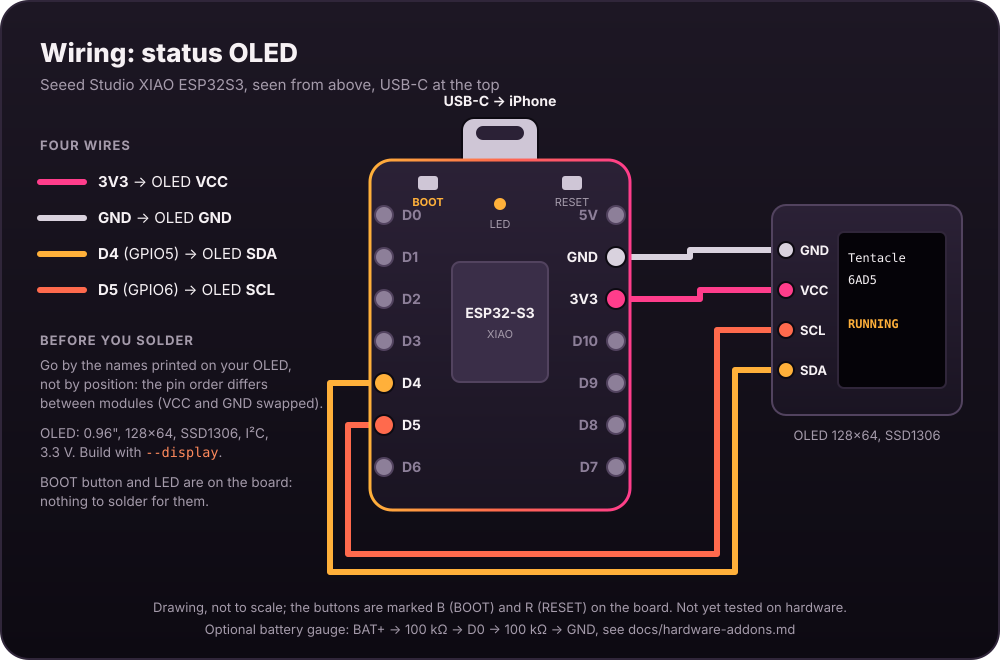
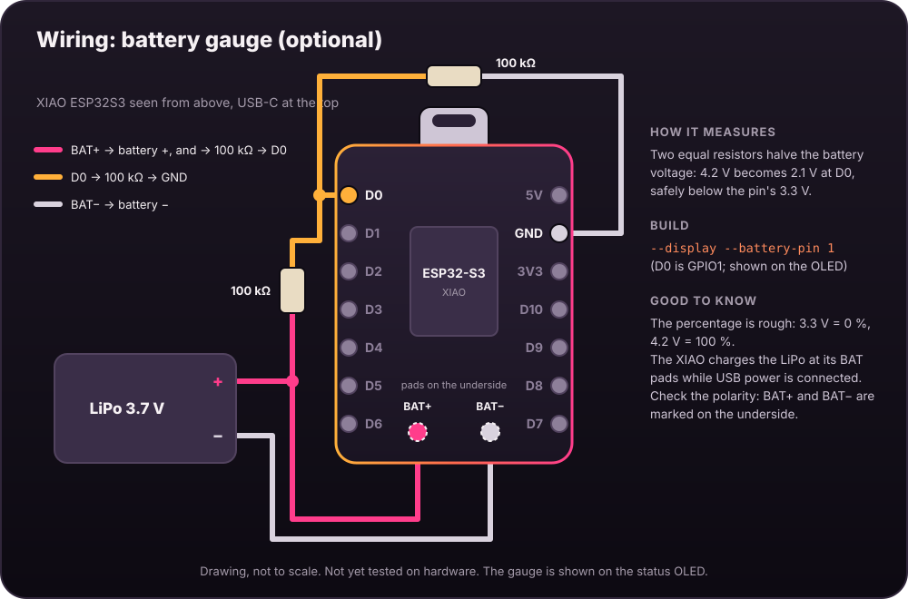

# Optional hardware add-ons

**English** · [Deutsch](hardware-addons.de.md)

Off by default; each needs the part physically wired. The firmware support is built in — enable it with a
build flag. Not yet tested on hardware. (The stop button needs no parts and is on by default; see
[hardening.md](hardening.md).)

## Status OLED (128×64 SSD1306, I²C) — `--display`
A 0.96″ SSD1306 OLED (a few euros) shows board name + firmware, network mode + IP, connection count, and
**RUNNING / STOPPED** (tied to the BOOT stop button). It also shows what you need at the board: the setup
Wi-Fi's name and password, `PAIRING OPEN` after a double press of BOOT, and the **pairing code** with the
computer's name while a request waits for the button. **Recommended:** without it the code cannot be compared.

Wiring (XIAO ESP32-S3 default I²C pins):

| OLED | XIAO |
|------|------|
| VCC  | 3V3  |
| GND  | GND  |
| SDA  | D4 (GPIO5) |
| SCL  | D5 (GPIO6) |

Build: `hardware/flash.sh --display`. Needs the U8g2 library once: `arduino-cli lib install U8g2`.

## Battery gauge (LiPo) — `--battery-pin <gpio>`
Reads the LiPo voltage through a divider on an ADC pin and shows a rough % on the OLED.

- Wire `BAT+ → 100 kΩ → D0 (GPIO1) → 100 kΩ → GND` (two equal resistors = 2:1 divider; keeps the pin ≤ 3.3 V).
- Build: `hardware/flash.sh --display --battery-pin 1`. With a different divider ratio, change
  `BATTERY_DIVIDER` in `hardware/hid_bridge/hid_bridge.ino`.
- The % curve is a rough 3.3 V = 0 % … 4.2 V = 100 %; calibrate for your cell.
- The XIAO ESP32-S3 charges a LiPo on its BAT pads, so board + phone can run portable.

## Case
Etsy/Printables have XIAO ESP32-S3 cases (plain version, USB-C end open). With an OLED or LiPo, pick a case
with an OLED window / battery bay, or have one printed.
