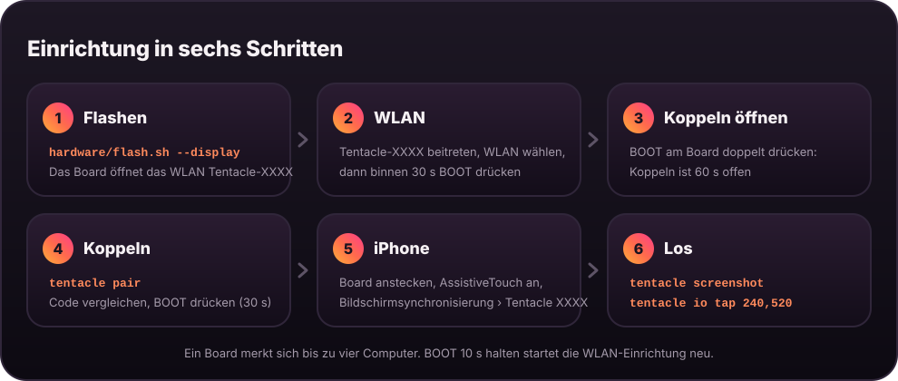
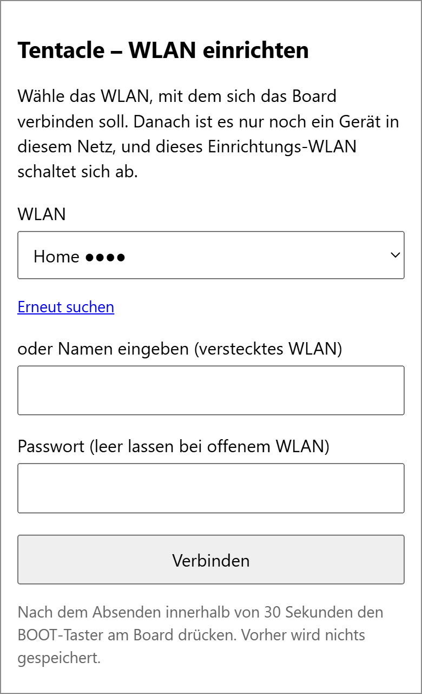
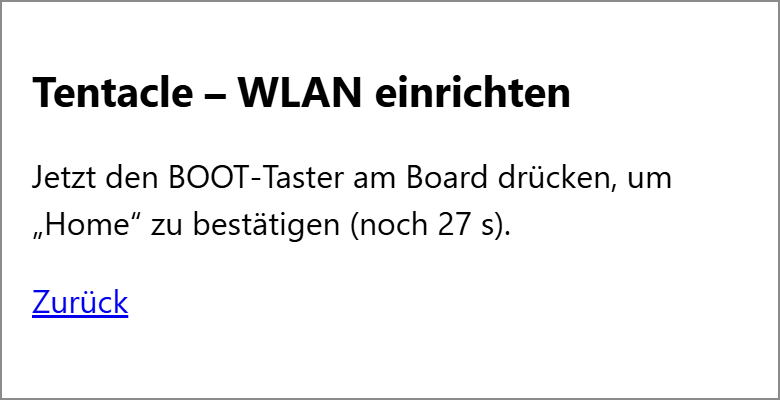
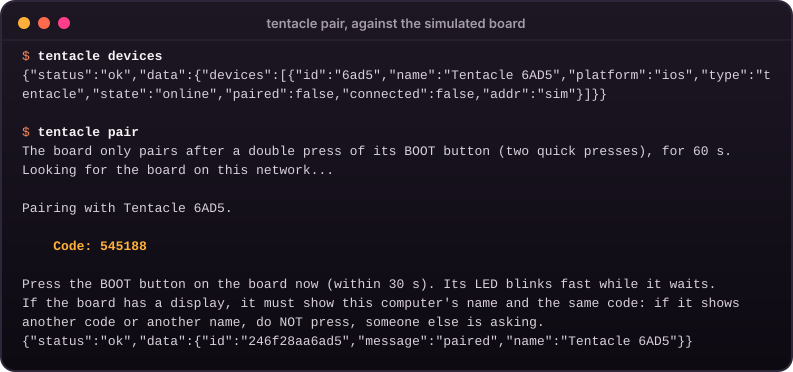
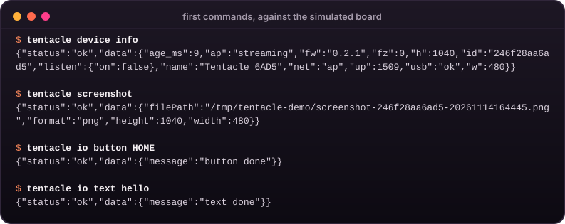
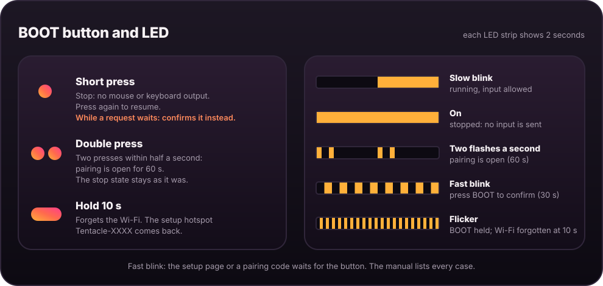
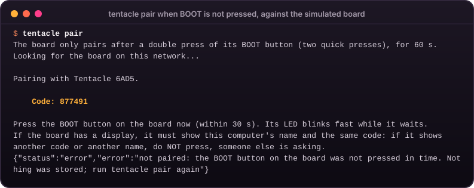

# Tentacle-Handbuch

[English](manual.md) · **Deutsch**

Vom leeren Board bis zum ersten Tipp auf dem Handy, und was Taste, LED und Display dir sagen.

> **Noch nicht auf Hardware getestet.** Alles auf dieser Seite stammt aus dem Quelltext und aus Tests am
> Computer (Host-Tests, ein simuliertes Board). Noch kein Build ist auf einem echten Board gelaufen; der erste
> Hardware-Test ist für den 17. November 2026 geplant. Wo die Wirklichkeit abweicht, irrt diese Seite, nicht das
> Board. Fotos folgen nach diesem Test.

## Inhalt

1. [Was du brauchst](#1-was-du-brauchst)
2. [Firmware flashen](#2-firmware-flashen)
3. [Das Board ins eigene WLAN bringen](#3-das-board-ins-eigene-wlan-bringen)
4. [Die CLI bauen](#4-die-cli-bauen)
5. [Den Computer koppeln](#5-den-computer-koppeln)
6. [Das iPhone vorbereiten](#6-das-iphone-vorbereiten)
7. [Erste Schritte](#7-erste-schritte)
8. [Nutzung mit einem KI-Assistenten (MCP)](#8-nutzung-mit-einem-ki-assistenten-mcp)
9. [Taste und LED](#9-taste-und-led)
10. [Das Display](#10-das-display)
11. [WLAN wechseln oder vergessen](#11-wlan-wechseln-oder-vergessen)
12. [Entkoppeln](#12-entkoppeln)
13. [Fehlersuche](#13-fehlersuche)
14. [Befehlsübersicht](#14-befehlsübersicht)
15. [Sicherheit in Kürze](#15-sicherheit-in-kürze)

<p align="center"></p>

## 1. Was du brauchst

| Teil | Hinweise |
|---|---|
| **Seeed Studio XIAO ESP32S3** (die einfache Version, 8 MB PSRAM) | Nicht Sense, nicht Plus. Klassische ESP32-Boards (ESP32-WROOM mit CH340-Chip) funktionieren nicht: kein natives USB, also keine Maus oder Tastatur. |
| **USB-C-auf-USB-C-Datenkabel**, kurz | Ein reines Ladekabel funktioniert nicht. |
| **iPhone mit USB-C**, iOS 18 oder neuer | Lightning-iPhones über einen Lightning-auf-USB-Kamera-Adapter: vom Originalprojekt übernommen, hier nicht ausprobiert. |
| **0,96″-OLED, 128×64, SSD1306, I²C** (4 Pins), empfohlen | Zeigt das Setup-WLAN mit Passwort, die Adresse des Boards und den Koppel-Code. Ohne OLED lässt sich der Code am Board nicht vergleichen. |
| Ein Computer im selben WLAN | Windows, macOS oder Linux, mit [arduino-cli](https://arduino.github.io/arduino-cli/) zum Flashen, [Go](https://go.dev/dl/) zum Bauen der CLI und `ffmpeg` für Screenshots. |
| Optional: LiPo 3,7 V, zwei 100-kΩ-Widerstände, Gehäuse | [hardware-addons.de.md](hardware-addons.de.md) |

OLED-Anschluss: VCC→3V3, GND→GND, SDA→D4 (GPIO5), SCL→D5 (GPIO6).

Das Board kann nur 2,4-GHz-WLAN (ESP32-S3). Computer, iPhone und Board müssen im selben Netz sein, und dieses
Netz muss seine Geräte miteinander reden lassen (viele Gastnetze tun das nicht).

> Foto folgt nach dem ersten Hardwaretest: das Board mit angeschlossenem OLED.

## 2. Firmware flashen

Einmal den ESP32-Core installieren, und die Bibliothek U8g2, wenn du das OLED benutzt:

```bash
git clone https://github.com/kewe87/phone-tentacle.git
cd phone-tentacle
arduino-cli core install esp32:esp32@3.3.12
arduino-cli lib install U8g2                 # nur für --display
```

### Linux und macOS

Das Board an den Computer stecken, dann:

```bash
hardware/flash.sh --display                  # mit OLED
hardware/flash.sh                            # ohne
```

Das Skript baut die Firmware, bringt ein laufendes Board in seinen Bootloader, lädt hoch und fragt das Board
danach nach seinem **Setup-WLAN**. Es zeigt den Namen (`Tentacle-XXXX`) und das Passwort an.
`hardware/flash.sh --info` fragt später noch einmal, ohne zu bauen.

Schlägt das Hochladen fehl, das Board in den Download-Modus bringen (BOOT halten und dabei einstecken) und das
Skript noch einmal starten.

| Option | |
|---|---|
| `--display` | Status auf dem OLED |
| `--battery-pin N` | Akkustand in Prozent auf dem OLED, gemessen an GPIO N ([hardware-addons.de.md](hardware-addons.de.md)) |
| `--name NAME` | Name des Boards in der Bildschirmsynchronisierung und für die CLI (ein Wort; Standard `Tentacle`). Das Setup-WLAN heißt immer `Tentacle-XXXX` |
| `--abs` | absolute statt relativer Maus (braucht AssistiveTouch; die CLI überspringt das Kalibrieren) |
| `--no-safety` | ohne Stopp-Taster und Statuslicht (BOOT bestätigt weiterhin Anfragen und vergisst das WLAN) |
| `--multi-client` | bis zu 4 Geräte dürfen ins Setup-WLAN statt 1 |
| `--build-only` | nur kompilieren |
| `--debug` | Inbetriebnahme-Build mit Debug-Schnittstelle über USB-Seriell. Er kann BOOT per Befehl drücken: nie weitergeben |

Alle Optionen stehen im Kopf von [`hardware/flash.sh`](../hardware/flash.sh).

### Windows

Im Repository liegt kein Flash-Skript für Windows. `hardware/flash.sh` ist ein Bash-Skript und sucht das Board
unter `/dev/cu.usbmodem*` und `/dev/ttyACM*`, also unter den Namen von macOS und Linux. Unter Windows die zwei
arduino-cli-Aufrufe des Skripts selbst ausführen, in PowerShell im Ordner des Repositorys. Der Pfad hinter
`-include` muss der volle Pfad von `build_cfg.h` sein, mit Schrägstrichen und ohne Leerzeichen:

```powershell
$fqbn = "esp32:esp32:esp32s3:USBMode=default,CDCOnBoot=cdc,FlashSize=8M,PSRAM=opi,PartitionScheme=default_8MB"
$defs = "-DSTATUS_DISPLAY=1 -include C:/src/phone-tentacle/hardware/hid_bridge/build_cfg.h"   # ohne OLED: -DSTATUS_DISPLAY=1 weglassen

arduino-cli compile -b $fqbn --build-property "compiler.cpp.extra_flags=$defs" --build-property "compiler.c.extra_flags=$defs" --output-dir hardware\build hardware\hid_bridge
arduino-cli upload  -b $fqbn -p COM5 --input-dir hardware\build hardware\hid_bridge
```

`COM5` ist der Anschluss des Boards (Geräte-Manager › Anschlüsse). Schlägt das Hochladen fehl, BOOT halten,
dabei das Board einstecken und noch einmal hochladen; die COM-Nummer kann sich ändern. Die übrigen Optionen von
`flash.sh` sind `-D`-Schalter in derselben Zeichenkette (`-DBOARD_NAME=Desk`, `-DABS_POINTER=1`,
`-DSAFETY_CONTROLS=0`, `-DAP_MAX_CLIENTS=4`, `-DBATTERY_PIN=1`).

Name und Passwort des Setup-WLANs stehen danach auf dem OLED. Ohne OLED das Board über seine serielle
Schnittstelle fragen: `arduino-cli monitor -p COM5 -c baudrate=115200` öffnen und `0 setup` senden. Das Board
antwortet mit einer Zeile:
`wifi-setup {"setup":1,"ssid":"Tentacle-1A2B","pass":"…","url":"http://192.168.4.1/"}`.

## 3. Das Board ins eigene WLAN bringen

Ein Board ohne gespeichertes WLAN öffnet ein eigenes: `Tentacle-XXXX`, WPA2, mit einem zufälligen
12-stelligen Passwort, das auf diesem Board erzeugt wurde. Es kann immer nur ein Gerät darin sein.

1. Mit Handy oder Laptop ins WLAN `Tentacle-XXXX` gehen, mit dem Passwort aus dem Flash-Skript oder vom OLED.
2. Die Einrichtungsseite öffnet sich von selbst. Sonst `http://192.168.4.1/` aufrufen. Die Seite ist deutsch,
   wenn dein Browser Deutsch bevorzugt, sonst englisch.
3. Das eigene WLAN aus der Liste wählen (die Punkte zeigen die Signalstärke) oder seinen Namen eingeben, dazu
   das Passwort.
4. **Innerhalb von 30 Sekunden BOOT am Board drücken.** Die Seite zählt herunter, die LED blinkt schnell, das
   OLED zeigt `PRESS BOOT TO CONFIRM` und den Namen des Netzes. Vor diesem Druck wird nichts gespeichert.

Das Board probiert das Netz dann aus. Klappt es, wird das Netz gespeichert, die Seite zeigt die Adresse des
Boards dort, und das Setup-WLAN schaltet sich ab. Ist das Passwort falsch oder das Netz nicht zu finden, sagt
die Seite das, und nichts wird gespeichert: zurück und noch einmal.

<p align="center">
  <picture>
    <source media="(prefers-color-scheme: dark)" srcset="images/setup-page-de-dark.png">
    
  </picture>
  <picture>
    <source media="(prefers-color-scheme: dark)" srcset="images/setup-confirm-de-dark.png">
    
  </picture>
</p>

<sub>Einrichtungsseite, aus dem Quelltext der Firmware gerendert (`setup_portal.cpp`), in einem Desktop-Browser
in Handybreite und mit ausgedachten WLAN-Namen. Auf einem Handy sehen die Formularfelder aus wie dort üblich.</sub>

## 4. Die CLI bauen

```bash
cd cli
go build -o tentacle ./cmd/tentacle          # Windows: -o tentacle.exe
```

Die Datei in einen Ordner legen, der im `PATH` steht. Screenshots brauchen `ffmpeg`
(`winget install Gyan.FFmpeg`, `brew install ffmpeg`, `apt install ffmpeg`). Releases und Installer gibt es
noch nicht.

## 5. Den Computer koppeln

Zum Koppeln musst du zweimal ans Board: einmal zum Öffnen, einmal zum Bestätigen.

1. `tentacle devices` sollte das Board als `Tentacle XXXX` auflisten.
2. **BOOT doppelt drücken** (zweimal innerhalb einer halben Sekunde). Das Koppeln ist 60 Sekunden offen: Die
   LED blitzt zweimal pro Sekunde, das OLED zeigt `PAIRING OPEN`.
3. `tentacle pair` starten. Es zeigt einen **6-stelligen Code**. Das OLED zeigt `PRESS BOOT TO CONFIRM`, den
   Namen deines Computers und denselben Code; die LED blinkt schnell.
4. Vergleichen. Stimmen Name und Code, innerhalb von 30 Sekunden **BOOT einmal drücken**. `tentacle pair`
   meldet `paired`.

Zeigt das OLED einen anderen Code oder einen Namen, den du nicht kennst: nicht drücken, dann fragt jemand
anderes. Du kannst `tentacle pair` auch zuerst starten; es wartet bis zu 60 Sekunden auf den Doppeldruck.

<p align="center"></p>

<sub>Ausgabe gegen das simulierte Board (`hardware/tests/sim`, der Verbindungscode der Firmware hinter einer
Pipe). `"addr":"sim"` steht dort, wo ein echtes Board seine Adresse zeigt.</sub>

Danach braucht dieser Computer keinen Tastendruck mehr. Ein Board merkt sich bis zu vier Computer; die
Schlüssel sind Dateien im Konfigurationsordner der CLI (`%AppData%\tentacle`,
`~/Library/Application Support/tentacle`, `~/.config/tentacle`).

> Foto folgt nach dem ersten Hardwaretest: das OLED mit dem Koppel-Code.

## 6. Das iPhone vorbereiten

1. Das Board vom Computer abziehen und mit dem Datenkabel ans iPhone stecken.
2. *Einstellungen › Bedienungshilfen › Tippen › AssistiveTouch* einschalten. Damit kann der Mauszeiger tippen.
3. Das iPhone ins selbe WLAN bringen wie das Board. Kontrollzentrum › **Bildschirmsynchronisierung** ›
   **Tentacle XXXX**.

iOS startet die Bildschirmsynchronisierung nur von Hand; das Board kann das nicht übernehmen. Sie endet, wenn
das Handy sperrt.

Prüfen mit `tentacle device info`: `"ap":"streaming"` heißt, das Bild kommt an; `"usb":"ok"` heißt, das Handy
sieht Maus und Tastatur (`"off"`: keine Datenverbindung, `"asleep"`: Handy entsperren).

> Foto folgt nach dem ersten Hardwaretest: das Board am iPhone, und Tentacle in der Liste der
> Bildschirmsynchronisierung.

## 7. Erste Schritte

```bash
tentacle screenshot             # schreibt ein PNG in den aktuellen Ordner und zeigt den Pfad
tentacle io button HOME         # zum Home-Bildschirm
tentacle io tap 240,520         # Koordinaten sind Pixel eines Screenshots in voller Größe
tentacle io swipe 240,800,240,300
tentacle io text 'hello'        # nur ASCII
tentacle io keys enter
```

Beim ersten Tipp vermisst die CLI den Zeiger von selbst; `tentacle calibrate` tut es auf Wunsch. Dafür muss der
Zeiger auf dem Bildschirm sichtbar sein. Landet ein Tipp daneben, `tentacle io tap X,Y --aim` versuchen.

Jeder Befehl antwortet mit einer Zeile JSON: `{"status":"ok","data":…}` oder
`{"status":"error","error":"…"}` (Exit-Code 1).

<p align="center"></p>

<sub>Ausgabe gegen das simulierte Board. Sein Bildschirm ist ein Testbild mit 480×1040 Pixeln, und es meldet
eine eigene Firmware-Nummer und Netzart; die Werte eines echten Boards sind andere.</sub>

## 8. Nutzung mit einem KI-Assistenten (MCP)

`tentacle mcp` ist ein MCP-Server über stdio. Jeder MCP-Client kann ihn nutzen:

```bash
claude mcp add tentacle -- tentacle mcp      # Claude Code
codex mcp add tentacle -- tentacle mcp       # Codex
tentacle skill install                       # optional: ein Skill mit Arbeitsschleife und Tippregeln
```

Andere Clients: `{ "mcpServers": { "tentacle": { "command": "tentacle", "args": ["mcp"] } } }`.

Werkzeuge: `screenshot`, `tap`, `longpress`, `swipe`, `type_text`, `press_key`, `press_button`, `device_info`,
dazu `history`, `intent_list`, `intent_show`, `intent_save`, `memory_recall`, `memory_add`. Die Schleife ist
immer: Screenshot, entscheiden, eine Aktion, wieder Screenshot.

Das Board in Reichweite behalten, solange ein Assistent das Handy bedient: Ein kurzer Druck auf BOOT stoppt
ihn. Die Screenshots deines Handys gehen an das Modell, das dein Assistent benutzt.

## 9. Taste und LED

Das Board hat eine Taste, BOOT, und eine LED.

<p align="center"></p>

| Druck | Wirkung |
|---|---|
| **Kurz** | Stoppt sofort alle Maus- und Tastaturausgaben; der nächste kurze Druck hebt den Stopp auf. Der Computer kann den Stopp nicht aufheben. |
| **Kurz, während eine Anfrage wartet** | Bestätigt die Anfrage (ein WLAN von der Einrichtungsseite oder einen Koppel-Code) und stoppt nicht. Ein Druck in der ersten Sekunde, nachdem die Anfrage erschienen ist, zählt nicht als Antwort; er ist ein gewöhnlicher kurzer Druck. |
| **Doppelt** (zweimal innerhalb von 0,5 s) | Öffnet das Koppeln für 60 s; ein weiterer Doppeldruck startet die 60 s neu. Der Stopp-Zustand bleibt, wie er vorher war. Solange ein gekoppelter Computer das Handy bedient oder eine Anfrage wartet, gibt es keinen Doppeldruck: Jeder Druck ist ein kurzer. |
| **10 s halten** | Vergisst das gespeicherte WLAN und öffnet wieder das Setup-WLAN. Gekoppelte Computer bleiben gekoppelt. Der Stopp-Zustand ändert sich nicht. |

| LED | Bedeutung |
|---|---|
| Blinkt langsam (1 s aus, 1 s an) | läuft, Eingaben erlaubt |
| Dauerhaft an | **gestoppt**: Es werden keine Eingaben gesendet |
| Zwei kurze Blitze pro Sekunde | Koppeln ist offen (60 s nach einem Doppeldruck). Im Stopp bleibt die LED an, und die Blitze sind kurze dunkle Lücken |
| Blinkt schnell (4-mal pro Sekunde) | eine Anfrage wartet auf BOOT: ein WLAN von der Einrichtungsseite oder ein Koppel-Code (30 s) |
| Flackert (10-mal pro Sekunde) | BOOT wird seit 2 s gehalten; nach 10 s wird das WLAN vergessen. Früher loslassen, und es war ein kurzer Druck |

Trifft mehreres zu, gilt das erste davon: Flackern, schnelles Blinken, zwei Blitze, dann gestoppt oder läuft.
Ein Build mit `--no-safety` hat keinen Stopp und kein Lebenszeichen: Seine LED ist aus, außer beim Flackern,
beim schnellen Blinken und bei den zwei Blitzen.

## 10. Das Display

Ein Build mit `--display` zeigt vier Zeilen auf dem OLED und erneuert sie zweimal pro Sekunde. Die Texte sind
englisch.

| Wann | Zeile 1 | Zeile 2 | Zeile 3 | Zeile 4 |
|---|---|---|---|---|
| Eine Anfrage wartet auf BOOT (Koppeln) | `PRESS BOOT TO CONFIRM` | Name des Computers | `Code 123456` | `27 s left` |
| Eine Anfrage wartet auf BOOT (WLAN) | `PRESS BOOT TO CONFIRM` | `Join this Wi-Fi?` | Name des Netzes | `27 s left` |
| Koppeln ist offen | `PAIRING OPEN` | `On the computer run:` | `tentacle pair` | `55 s left` |
| Kein WLAN gespeichert (Einrichtung) | `Wi-Fi setup: join` | `Tentacle-1A2B` | `PW ` und das Passwort | `http://192.168.4.1` |
| Sonst | `Tentacle 0.1.0` | `net sta 192.168.1.50` | `peers 1  cli 1` | `running` oder `STOPPED` |

In der letzten Zeile der Tabelle ist `net` entweder `sta` (in deinem WLAN), `ap` (Setup-WLAN) oder `none` (dein
WLAN ist nicht erreichbar; Zeile 3 lautet dann `no Wi-Fi: BOOT 10s=new`). `cli 1` heißt, die Sitzung eines
Computers steht. Mit `--battery-pin` zeigt Zeile 4 zusätzlich `bat 87%`.

> Foto folgt nach dem ersten Hardwaretest: die vier Ansichten des OLEDs.

## 11. WLAN wechseln oder vergessen

| Du willst | So geht es |
|---|---|
| Das WLAN des Boards sehen | `tentacle net` |
| Das Board von einem gekoppelten Computer aus in ein anderes WLAN bringen | `tentacle net join` (fragt nach Name und Passwort; das Passwort wird nicht angezeigt) oder `tentacle net join SSID PASSWORT`. Geht über die verschlüsselte Sitzung, ohne Taste. Computer und iPhone müssen ebenfalls in dieses WLAN |
| Von einem gekoppelten Computer aus neu anfangen | `tentacle net hotspot`: Das Board vergisst sein WLAN und öffnet wieder `Tentacle-XXXX` |
| Am Board neu anfangen | BOOT 10 s halten, dann [Schritt 3](#3-das-board-ins-eigene-wlan-bringen) wiederholen |

Das Setup-WLAN kommt nicht von selbst zurück, wenn dein WLAN ausfällt. Ein Board, das nicht ins Netz kommt,
versucht es weiter; das OLED zeigt dann `no Wi-Fi: BOOT 10s=new`.

## 12. Entkoppeln

| Befehl | |
|---|---|
| `tentacle unpair` | Dieser Computer vergisst das Board. Das Board behält den Schlüssel dieses Computers, bis er ersetzt wird (es hält vier) |
| `tentacle unpair --board` | Auch das Board vergisst alle gekoppelten Computer. Jeder muss neu koppeln, mit der Taste |

Das WLAN zu vergessen (BOOT 10 s halten) entkoppelt nichts.

## 13. Fehlersuche

`tentacle --verbose <Befehl>` zeigt, wie das Board gefunden wird, den Handshake und die Zeiten.
`tentacle logs --save` schreibt das Log der CLI und das des Boards in eine Datei; nichts wird irgendwohin
gesendet. Die Meldungen der CLI sind englisch.

| Was du siehst | Was zu tun ist |
|---|---|
| `not found on the network …` | Hat das Board Strom, und ist es im selben WLAN wie der Computer (OLED: `net sta` und eine Adresse)? Die CLI findet es über mDNS (Multicast, UDP 5353) und, wenn das nichts bringt, indem sie TCP 7202 im lokalen Netz durchprobiert. Eine Firewall am Computer oder ein Gastnetz, das Geräte trennt, verhindert beides. Die Adresse von Hand angeben: `tentacle --host 192.168.1.50 devices`. Sie wird von da an behalten; `--host auto` sucht wieder |
| Die Windows-Firewall fragt nach `tentacle` | In privaten Netzen erlauben |
| Mehrere Boards | `--device ID` oder `TENTACLE_DEVICE` (die 12-stellige Hex-ID oder die 4 Hex-Ziffern aus dem Namen) |
| `pairing is closed on the board …` | Der Doppeldruck wurde nicht erkannt, oder die 60 s sind um. Noch einmal doppelt drücken (zwei klare, zügige Drücke); `tentacle pair` wartet bis zu 60 s weiter |
| `not paired: the BOOT button on the board was not pressed in time` | Von vorn: Doppeldruck, `tentacle pair`, ein Druck |
| `busy: pairing locked for N s` | Eine Anfrage endete ohne Taste. Das Board sperrt das Koppeln für 5 s, dann 10, 20 … bis 5 Minuten. Warten |
| `busy: another pairing request is open` | Ein anderer Computer fragt gerade. Den Namen auf dem OLED prüfen |
| `busy: board in use …` | Ein gekoppelter Computer hat eine Sitzung. Beenden und 10 s warten |
| `busy: the board waits for another confirmation (Wi-Fi setup)` | Die Anfrage der Einrichtungsseite abschließen oder ablaufen lassen (30 s) |
| `stopped (safety button)` | Der Stopp ist aktiv (LED an, OLED `STOPPED`). BOOT einmal drücken |
| Ein einzelner Druck hat das Board versehentlich gestoppt | Noch einmal drücken |
| `phone usb asleep (unlock the phone)` | Das iPhone entsperren |
| `no video (start screen mirroring)` | Die Bildschirmsynchronisierung am iPhone starten |
| `video frozen (restart screen mirroring)` | Die Bildschirmsynchronisierung stoppen und neu starten |
| `waiting for keyframe` | Am Handy etwas auf dem Bildschirm ändern (eine App öffnen), dann noch einmal |
| `calibration: pointer not found on screen …` | AssistiveTouch an? Zeiger sichtbar? Bildschirmsynchronisierung an? Dann `tentacle calibrate` |
| Die Einrichtungsseite öffnet sich nicht | Am Handy kurz die mobilen Daten ausschalten, dann `http://192.168.4.1/` aufrufen |
| Die Einrichtungsseite meldet, der Taster sei nicht rechtzeitig gedrückt worden | Das Formular noch einmal absenden, dann drücken |
| `Tentacle XXXX` fehlt in der Bildschirmsynchronisierung | iPhone im selben WLAN? Das Board abziehen und wieder anstecken; es braucht ein paar Sekunden ins Netz |

<p align="center"></p>

<sub>Ausgabe gegen das simulierte Board, ohne dass jemand BOOT drückt (der Simulator hat 3 s gewartet statt der
30 s des Boards).</sub>

## 14. Befehlsübersicht

Die Ausgabe von `tentacle help` (englisch):

```text
tentacle: see and drive an iPhone through a Tentacle board, over Wi-Fi.

  devices                          boards on this network (found by mDNS)
  pair                             pair this computer. First double-press BOOT on the board (pairing opens for
                                   60 s). The board then shows this computer's name and a 6-digit code (OLED),
                                   its LED blinks; compare the code, press BOOT once more within 30 s
  unpair [--board]                 forget the board here; --board: the board forgets every paired computer too
  screenshot [--format png|jpeg] [--quality N] [--scale F] [--max-size N] [--output PATH|-]
  io tap X,Y [--aim] [--count N]   coordinates are screenshot pixels; --count 2 double-taps
  io longpress X,Y [--duration MS]
  io swipe X1,Y1,X2,Y2
  io text 'TEXT'                   ASCII; Chinese is typed as pinyin
  io keys COMBO                    enter, esc, tab, backspace, space, up, cmd+a, ...
  io button HOME
  screencapture --format h264|mjpeg   video to stdout
  device info                      board status
  net                              the board's Wi-Fi
  net join                         the board moves to another Wi-Fi: asks for its name and password and sends them
                                   over the current link (sealed). A new board is set up on its own hotspot's page.
  net join SSID [PASSWORD]         the same, non-interactive
  net hotspot                      the board forgets its Wi-Fi and opens its setup hotspot again
  calibrate                        measure the pointer (automatic on the first tap)
  listen                           what the iPhone played in the last 30 s, as words (or why it can't be heard)
  listen on|off                    hear the phone's sound while it mirrors (off by default); the words are made
                                   by whisper.cpp on this computer (install whisper-cpp, plus a model)
  listen lang CODE|none            the language besides English (e.g. zh); default this computer's
  history list | show RUN | new    what was done on the phone (runs; a new one after 10 min idle)
  intent list | show NAME          saved intents (tasks that worked, with their steps)
  intent save --name N --prompt P [--hint H ...] [--from-run RUN [--steps 1,3,4]]
  intent delete NAME
  intent export NAME... [--screenshots] [--output FILE]   one .esp32intent file, to move intents to another computer
  intent import FILE
  memory list | search TEXT        what the agent remembers (MEMORY.md in the config directory)
  memory add TEXT [--kind preference|fact|app] [--topic APP]
  memory rm ID
  memory export [--output FILE]    a copy of MEMORY.md, e.g. for another computer
  memory import FILE               fold in an exported copy: same id or words keep the newer
  mcp                              MCP server on stdio
  skill install                    agent skill for Claude Code / Codex
  logs [--board] [--save]          the CLI's log; --board the board's; --save both in one file (e.g. for an issue)
  daemon [stop]                    the background process (started automatically)
  version

  --device ID or TENTACLE_DEVICE when several boards are around.
  --host IP[:PORT] or TENTACLE_HOST: the board's address, when it is not found by itself (--host auto: find again).
  --verbose or TENTACLE_VERBOSE=1: show how the board is found, the handshake and timings (also in the daemon's log).
```

Das Innenleben der CLI (der Hintergrundprozess, Verlauf, Intents, Gedächtnis, Grenzen):
[cli/README.md](../cli/README.md) (englisch).

## 15. Sicherheit in Kürze

- **Ein Weg vom Computer hinein:** TCP 7202, authentifiziert und verschlüsselt. Kein Bluetooth, keine App auf
  dem Handy.
- **Koppeln und WLAN-Einrichtung brauchen jemanden am Board.** Nichts im Netz kann das Board dazu bringen, nach
  seiner Taste zu fragen: Außerhalb der 60 s nach einem Doppeldruck bekommt eine Koppel-Anfrage einen Fehler,
  sonst geschieht nichts.
- **Der Stopp-Taster** wirkt nur am Board; der Computer kann ihn nicht aufheben.
- **Offen im eigenen Netz:** der AirPlay-Empfänger, Port 7202 und mDNS. Jeder im selben WLAN kann eine
  Spiegelung zum Board starten oder versuchen, es zum Absturz zu bringen; den Bildschirm sehen oder Eingaben
  schicken kann nur ein gekoppelter Computer.
- **Ohne OLED** lässt sich der Koppel-Code nicht vergleichen. Die Tastendrücke sagen dann nur „jetzt darf ein
  Computer koppeln“.
- **Wer das Board in der Hand hat, dem gehört es:** BOOT 10 s halten öffnet das Setup-WLAN, und USB-Seriell
  nimmt Befehle ohne Koppeln an. Das Board abziehen, wenn nichts das Handy bedienen soll.

Alles dazu, mit den offenen Punkten: [hardening.de.md](hardening.de.md). Ein Problem melden:
[SECURITY.md](../SECURITY.md).

Nur Geräte und Konten automatisieren, die dir gehören oder die du benutzen darfst.

---

Basiert auf [ESP32 iPhone Agent](https://github.com/onehumanbeing/esp32-iphone-agent) von Henry Yuan (MIT).
