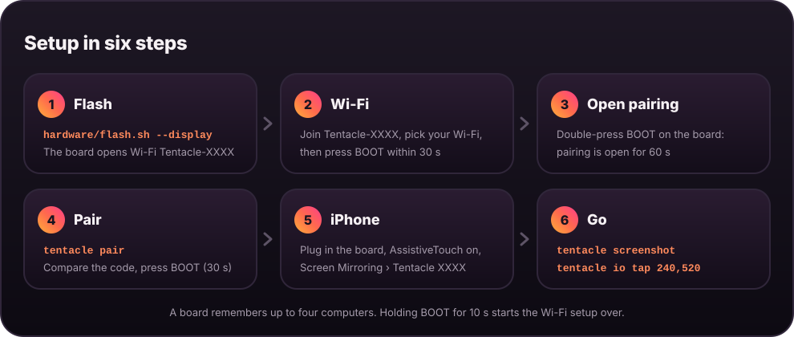
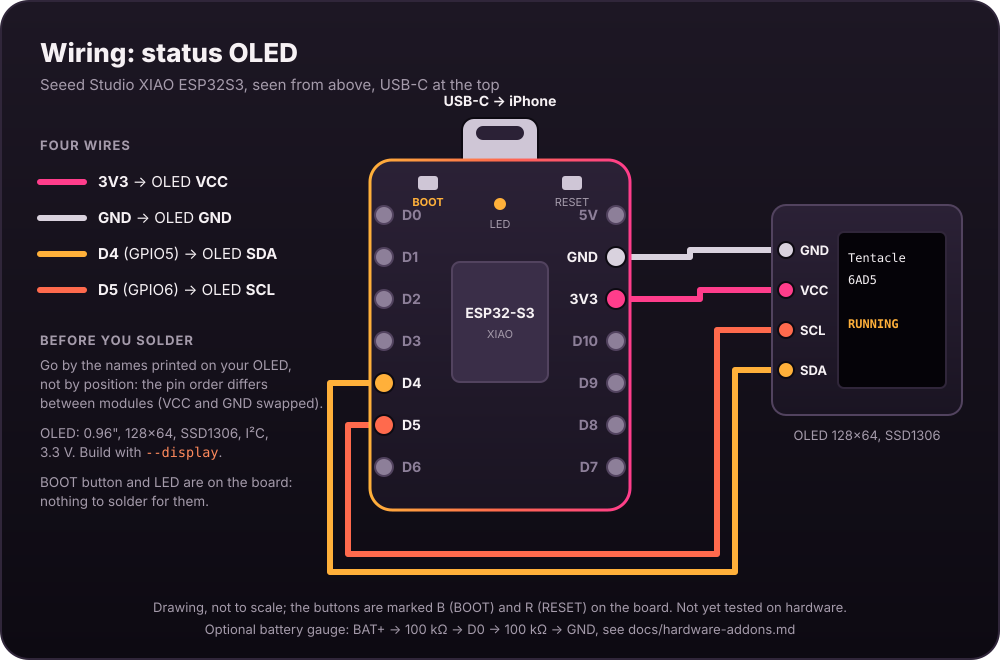
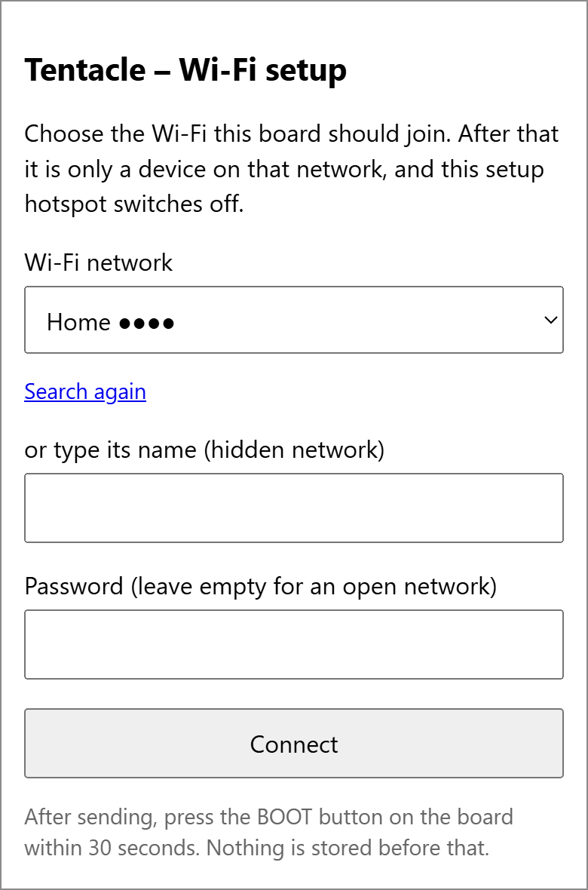
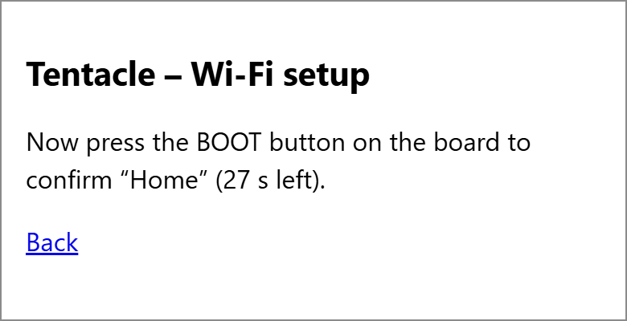
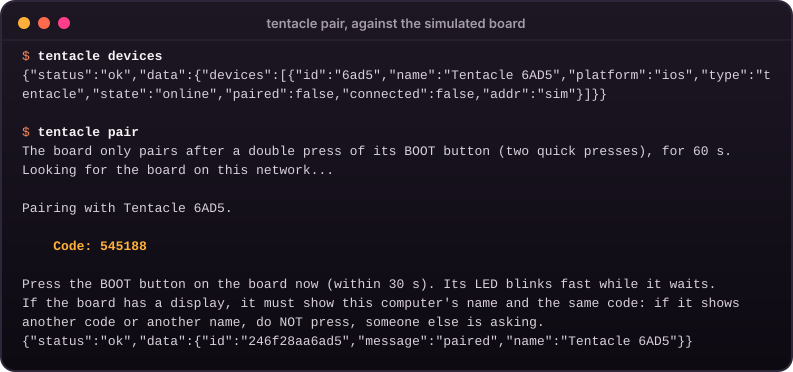
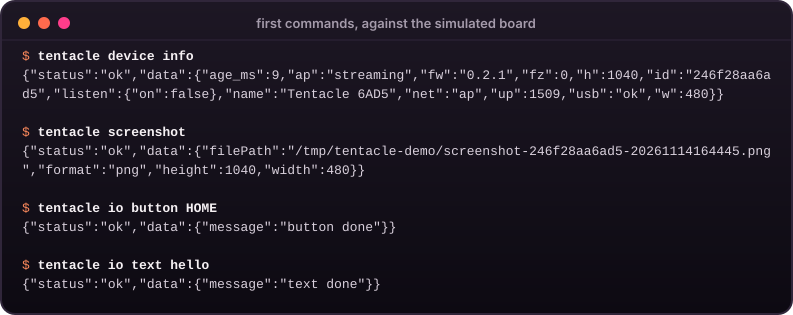
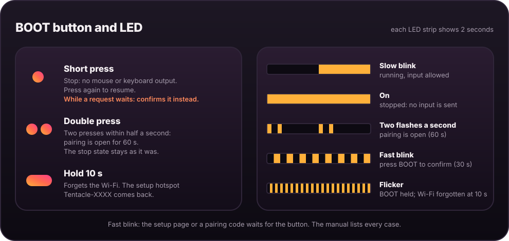
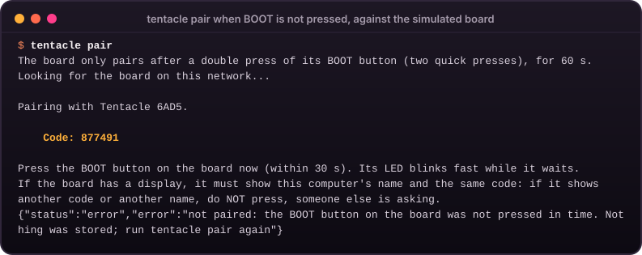

# Tentacle manual

**English** · [Deutsch](manual.de.md)

From a bare board to the first tap on the phone, and what the button, the LED and the display tell you.

> **Not yet tested on hardware.** Everything on this page is taken from the source code and from tests on the
> computer (host tests, a simulated board). No build has run on a real board yet; the first hardware test is
> planned for 17 November 2026. Where reality differs, this page is wrong, not the board. Photos follow after
> that test.

## Contents

1. [What you need](#1-what-you-need)
2. [Flash the firmware](#2-flash-the-firmware)
3. [Put the board on your Wi-Fi](#3-put-the-board-on-your-wi-fi)
4. [Build the CLI](#4-build-the-cli)
5. [Pair the computer](#5-pair-the-computer)
6. [Prepare the iPhone](#6-prepare-the-iphone)
7. [First steps](#7-first-steps)
8. [Use it with an AI assistant (MCP)](#8-use-it-with-an-ai-assistant-mcp)
9. [Button and LED](#9-button-and-led)
10. [The display](#10-the-display)
11. [Change or forget the Wi-Fi](#11-change-or-forget-the-wi-fi)
12. [Unpair](#12-unpair)
13. [Troubleshooting](#13-troubleshooting)
14. [Command overview](#14-command-overview)
15. [Security in short](#15-security-in-short)
16. [The web interface](#16-the-web-interface)

<p align="center"></p>

## 1. What you need

| Part | Notes |
|---|---|
| **Seeed Studio XIAO ESP32S3** (the plain one, 8 MB PSRAM) | Not the Sense, not the Plus. Classic ESP32 boards (ESP32-WROOM with a CH340 chip) do not work: no native USB, so they cannot be a mouse or keyboard. |
| **The Wi-Fi antenna** that comes with the XIAO ESP32S3 | **Required.** The board has no antenna of its own; see below. |
| **USB-C to USB-C data cable**, short | A charge-only cable does not work. |
| **iPhone with USB-C**, iOS 18 or later | Lightning iPhones through a Lightning to USB Camera Adapter: taken over from the original project, not tried here. |
| **0.96″ OLED, 128×64, SSD1306, I²C** (4 pins), recommended | Shows the setup Wi-Fi and its password, the board's address and the pairing code. Without it the code cannot be compared at the board. |
| A computer on the same Wi-Fi | Windows, macOS or Linux, with tentacle-flash or [arduino-cli](https://arduino.github.io/arduino-cli/) to flash, [Go](https://go.dev/dl/) to build the CLI and `ffmpeg` for screenshots. |
| Optional: LiPo 3.7 V, two 100 kΩ resistors, a case | [hardware-addons.md](hardware-addons.md) |

OLED wiring: VCC→3V3, GND→GND, SDA→D4 (GPIO5), SCL→D5 (GPIO6).

<p align="center"></p>


The board's Wi-Fi is 2.4 GHz only (ESP32-S3). The computer, the iPhone and the board have to be on the same
network, and that network must let its devices talk to each other (many guest networks do not).

> **Plug in the Wi-Fi antenna before you power the board.** The XIAO ESP32S3 has no antenna on the board, only a
> tiny snap-on socket (U.FL/IPEX) for the flat antenna in the box: press its plug straight on until it clicks.
> Without it the setup Wi-Fi `Tentacle-XXXX` does not show up at all, or only right next to the board, and the
> link to your network is very weak (dropouts, slow screenshots). Put the antenna away from the iPhone and from
> metal (not under the phone, not on or in a metal case or desk).
> `tentacle device info` shows the signal as `rssi` (dBm): about -70 or better is good. **Below about -80 dBm
> firmware updates over Wi-Fi fail**; then update over USB with `tentacle-flash` ([step 2](#2-flash-the-firmware))
> and fix the antenna or move the board closer to the router.

> Photo follows after the first hardware test: the board with the OLED wired.

## 2. Flash the firmware

There are two ways: `tentacle-flash`, a single program with nothing else to install, or building the firmware
yourself with arduino-cli (all build options, see below).

### Flashing the easy way: tentacle-flash

`tentacle-flash` carries the firmware inside and writes it over USB, without arduino-cli, Python or drivers. A release
(tag `vX.Y.Z`) has one archive per system: `tentacle-flash_windows_amd64.zip`, `tentacle-flash_darwin_universal.tar.gz`
(Apple silicon and Intel) and `tentacle-flash_linux_amd64.tar.gz` / `_linux_arm64.tar.gz`, each with the one file
`tentacle-flash`. There are no published releases yet; until then build the files yourself (needs [Go](https://go.dev/dl/) and a firmware build, see [cli/README.md](../cli/README.md#tentacle-flash)).

1. Plug the board into the computer with the USB-C data cable.
2. Double-click `tentacle-flash`. A page opens in the browser (it runs only on this computer, at `127.0.0.1`), in
   English or German, following the system; the button at the top right switches.
3. The page shows the board it found and the firmware. Click **Install**. It finds the board, puts it into
   download mode by itself, writes the firmware, checks it and restarts the board. This takes about a minute.
4. **Done.** The page shows the board's setup Wi-Fi `Tentacle-XXXX` with its password and a QR code: scan it
   with the phone's camera and go on with [step 3](#3-put-the-board-on-your-wi-fi).

A stored Wi-Fi and the pairing stay on the board; only the firmware is replaced. Under **Advanced** you can
choose the port, install your own `.merged.bin`, erase the whole flash first (this removes the
Wi-Fi and the pairing too), read the chip info and see the log.

Before it writes anything, `tentacle-flash` checks that the board is an ESP32-S3 with at least 8 MB flash (and
warns if it has no PSRAM), and that the firmware is signed with the Tentacle release key. A wrongly signed image
is refused; an unsigned one (your own build) is installed with a warning.

On the command line, without the browser:

```sh
tentacle-flash --yes                         # find the board, install, show the setup Wi-Fi as a QR code
tentacle-flash --yes --port COM5 --image hardware/build/hid_bridge.ino.merged.bin
tentacle-flash --yes --erase                 # erase the whole flash first
tentacle-flash --info                        # ask a running board for its setup Wi-Fi again
tentacle-flash --chip                        # chip, flash size, PSRAM, MAC
tentacle-flash --list                        # serial ports, and which one is the board
```

If it goes wrong:

- **"did not switch into download mode"**: do it by hand. Hold the BOOT button (B), press and release RESET (R),
  let go of BOOT, then click Install again. The two tiny buttons sit next to the USB-C socket.
- **No board found**: try another cable (charge-only cables do not carry data) and another USB port, directly
  on the computer rather than through a hub.
- **Port cannot be opened**: close the Arduino IDE or a serial monitor. On Linux, add yourself to the `dialout`
  group (Arch: `uucp`): `sudo usermod -aG dialout $USER`, then log out and in again.
- **Windows** may warn about an unknown program ("Windows protected your PC"): More info › Run anyway.
  **macOS** opens downloaded programs only after a confirmation: right-click › Open, or
  `xattr -d com.apple.quarantine tentacle-flash_darwin_universal` and `chmod +x` it first.

The firmware in `tentacle-flash` is the one release image for every board (from 0.4.0). The status OLED, the
absolute or relative pointer, the battery pin and the OLED's language are settings on the board, not build
options: see [Board settings](#board-settings). Build it yourself only to change the code, or for `--name`,
`--no-safety` or `--multi-client`; you can then install your `.merged.bin` with `tentacle-flash` (Advanced, or
`--image`) or with the script.

### Building it yourself with arduino-cli

Install the ESP32 core and the U8g2 library (the OLED's) once:

```bash
git clone https://github.com/kewe87/phone-tentacle.git
cd phone-tentacle
arduino-cli core install esp32:esp32@3.3.12
arduino-cli lib install U8g2
```

#### Linux and macOS

Plug the board into the computer, then:

```bash
hardware/flash.sh
```

The script builds the firmware, puts a running board into its bootloader, uploads, and then asks the board for
its **setup Wi-Fi**. It prints the name (`Tentacle-XXXX`) and the password. `hardware/flash.sh --info` asks
again later without building.

If the upload fails, put the board into download mode (hold BOOT while plugging it in) and run the script again.

| Option | |
|---|---|
| `--name NAME` | the board's name in Screen Mirroring and for the CLI until another is set (one word; default `Tentacle`). The setup Wi-Fi is always `Tentacle-XXXX` |
| `--no-safety` | no stop button and no status light (BOOT still confirms requests and forgets the Wi-Fi) |
| `--multi-client` | up to 4 devices may join the setup Wi-Fi instead of 1 |
| `--build-only` | compile only |
| `--debug` | bring-up build with a debug interface on USB serial. It can press BOOT from the serial port: never hand out such a build |

All options are listed in the header of [`hardware/flash.sh`](../hardware/flash.sh). The old `--display`,
`--abs` and `--battery-pin` are accepted and ignored.

#### Board settings

The board keeps these settings across restarts and firmware updates. Change them from a paired computer with
`tentacle device set KEY VALUE` (`tentacle device settings` shows them), or on the web interface (Settings ›
Hardware):

| Key | Values | Default | |
|---|---|---|---|
| `display` | `auto`, `on`, `off` | `auto` | the status OLED ([hardware-addons.md](hardware-addons.md)): `auto` uses it when one answers on I2C (GPIO5 SDA, GPIO6 SCL, address 0x3C or 0x3D) at boot or when the setting changes; `on` draws even when none answers; `off` leaves the I2C pins alone |
| `abs` | `on`, `off` | `on` | `on`: the absolute pointer (needs AssistiveTouch; no calibration, clicks on the web page's picture work). `off`: the classic relative mouse, which the CLI calibrates. Takes effect after a restart (unplug the board, or Restart on the web interface) |
| `battery` | `none`, a GPIO (1-4, 7-10) | `none` | the LiPo voltage pin: the OLED and the status show the charge in % |
| `battery_div` | `1.00` to `10.00` | `2.00` | battery volts per pin volt (2.00 for a 2:1 divider) |
| `lang` | `auto`, `en`, `de` | `auto` | the OLED's language; `auto` is the web interface's language when one is set, else English |
| `name` | 1-20 of `A-Z a-z 0-9 space . _ -` | `Tentacle` | as on the web interface; takes effect after a restart |
| `sdlog` | `off`, `log`, `video` (`on` = `video`) | `off` | the recording on the microSD card, boards with a slot only ([Waveshare e-paper board](hardware-addons.md#waveshare-esp32-s3-epaper-154-e-paper-clock-microsd)): `log` the board's log and every input (typed text only as its length), `video` the log and the mirrored screen |

#### Windows

The repository has no flash script for Windows (tentacle-flash above needs none). `hardware/flash.sh` is a bash
script and looks for the board under `/dev/cu.usbmodem*` and `/dev/ttyACM*`, which are macOS and Linux names. On Windows, run the two
arduino-cli calls the script makes yourself, in PowerShell from the repository's folder. The path after
`-include` has to be the full path of `build_cfg.h`, with forward slashes and without spaces:

```powershell
$fqbn = "esp32:esp32:esp32s3:USBMode=default,CDCOnBoot=cdc,FlashSize=8M,PSRAM=opi,PartitionScheme=default_8MB"
$defs = "-include C:/src/phone-tentacle/hardware/hid_bridge/build_cfg.h"

arduino-cli compile -b $fqbn --build-property "compiler.cpp.extra_flags=$defs" --build-property "compiler.c.extra_flags=$defs" --output-dir hardware\build hardware\hid_bridge
arduino-cli upload  -b $fqbn -p COM5 --input-dir hardware\build hardware\hid_bridge
```

`COM5` is the board's port (Device Manager › Ports). If the upload fails, hold BOOT while plugging the board in
and upload again; the port number can change. The other options of `flash.sh` are `-D` switches in the same
string, before `-include` (`-DBOARD_NAME=Desk`, `-DSAFETY_CONTROLS=0`, `-DAP_MAX_CLIENTS=4`).

The setup Wi-Fi's name and password are then on the OLED, if the board has one. Without an OLED, ask the board on its serial port:
open `arduino-cli monitor -p COM5 -c baudrate=115200` and send `0 setup`. The board answers with one line:
`wifi-setup {"setup":1,"ssid":"Tentacle-1A2B","pass":"…","url":"http://192.168.4.1/","qr":"…"}`
(`qr` is the Wi-Fi QR code, one hex string per row).

### Later updates over Wi-Fi

Once the board is paired (step 5), a newer firmware goes over Wi-Fi, without the USB cable:

```sh
tentacle update hardware/build/hid_bridge.ino.bin
```

Use the `.ino.bin` file (not `.merged.bin` or the bootloader). The CLI shows the progress, waits for the board
to restart and prints `updated: 0.1.0 -> 0.2.0`. A 1.4 MB image takes well under a minute.

**Afterwards start Screen Mirroring again.** The restart ends the mirroring session, and the iPhone does not start
a new one by itself: Control Center › Screen Mirroring › Tentacle XXXX (if it still shows as connected, Stop
Mirroring first). Until then screenshots fail or show an old picture.

- **Only signed firmware.** The board takes only images signed with the Tentacle release key; the signature is
  inside the image file, and `tentacle update` sends it along. An unsigned or wrongly signed image is
  refused before a byte is written. A `--debug` build also takes unsigned images, so you can update your own
  builds of it over Wi-Fi; a normal build you made yourself goes over USB.
- **Nothing breaks halfway.** The image goes into the board's second firmware slot. If the link drops, you press
  Ctrl+C, or the image is damaged, the board keeps the firmware it has.
- **Automatic rollback.** The new firmware is on trial until a computer has connected to it, or until its Wi-Fi
  has worked for 30 s. If it crashes or restarts before that, or finds no Wi-Fi within 2 minutes, the board starts
  the previous firmware again, and `tentacle update` says so.
- The first firmware that can do this (0.2.0) has to be flashed over USB once.
- **A weak Wi-Fi signal makes the update fail.** Below about -80 dBm (`rssi` in `tentacle device info`) the image
  does not get through; the board keeps its firmware. Check the antenna ([step 1](#1-what-you-need)) or update
  over USB with `tentacle-flash`.

With a `--debug` build, `tentacle logs --board --follow` shows the board's log as it is written, and
`tentacle debug state` (or `nvs`, `wifi`, `wifi scan`, `reboot`) runs its serial debug commands over Wi-Fi.

## 3. Put the board on your Wi-Fi

A board without a stored Wi-Fi opens its own: `Tentacle-XXXX`, WPA2, with a random 12-character password made
on that board. One device can be on it at a time.

1. Join `Tentacle-XXXX` with a phone or laptop, using the password from the flash script or the OLED. Quicker:
   scan the QR code on the OLED or in the flash script's output with the phone's camera; it joins without typing
   the password.
2. The setup page opens by itself. If not, open `http://192.168.4.1/`. The page is German if your browser
   prefers German, otherwise English.
3. Choose your Wi-Fi from the list (the dots show the signal strength) or type its name, and enter its password.
   Optional: a password for the board's [web interface](#16-the-web-interface), twice.
   Under **The board**: its name, the iPhone's keyboard layout and, on a board with a microSD slot, the recording.
   "Deutsch · English" at the top switches the page; the language you choose is also the web interface's and the
   display's. All of it is stored with the network, only after the press of BOOT; a new name restarts the board
   once the setup is done.
4. **Press BOOT on the board within 30 seconds.** The page counts down, the LED blinks fast, the OLED says
   `PRESS BOOT TO CONFIRM` with the network's name. Nothing is stored before that press.

The board then tries the network. If it works, the network is stored, the page shows the board's address there,
and the setup Wi-Fi switches off. If the password is wrong or the network is not found, the page says so and
nothing is stored: go back and try again.

<p align="center">
  
  
</p>

<sub>The setup page, rendered from the firmware's source code (`setup_portal.cpp`) in a desktop browser at phone
width, with made-up network names. On a phone the form controls look like that phone's.</sub>

## 4. Build the CLI

```bash
cd cli
go build -o tentacle ./cmd/tentacle          # Windows: -o tentacle.exe
```

Put the binary somewhere on your `PATH`. Screenshots need `ffmpeg` (`winget install Gyan.FFmpeg`,
`brew install ffmpeg`, `apt install ffmpeg`). Once a release is published, `cli/install/install.sh` (macOS, Linux)
and `cli/install/install.ps1` (Windows) download `tentacle` from it and check it against its `SHA256SUMS`.

## 5. Pair the computer

Pairing needs you at the board twice: once to open it, once to confirm.

1. `tentacle devices` should list the board as `Tentacle XXXX`.
2. **Double-press BOOT** (two presses within half a second). Pairing is open for 60 seconds: the LED flashes
   twice a second, the OLED says `PAIRING OPEN`.
3. Run `tentacle pair`. It prints a **6-digit code**. The OLED shows `PRESS BOOT TO CONFIRM`, your computer's
   name and the same code; the LED blinks fast.
4. Compare. If the name and the code match, **press BOOT once** within 30 seconds. `tentacle pair` answers
   `paired`.

If the OLED shows another code or a name you do not know, do not press: someone else is asking.
You can also start `tentacle pair` first; it waits up to 60 seconds for the double press.

<p align="center"></p>

<sub>Output against the simulated board (`hardware/tests/sim`, the firmware's own link code behind a pipe).
`"addr":"sim"` stands where a real board shows its address.</sub>

From then on this computer needs no button press. A board remembers up to four computers; the keys are files in
the CLI's config directory (`%AppData%\tentacle`, `~/Library/Application Support/tentacle`,
`~/.config/tentacle`).

> Photo follows after the first hardware test: the OLED showing the pairing code.

## 6. Prepare the iPhone

1. Unplug the board from the computer and plug it into the iPhone with the data cable.
2. *Settings › Accessibility › Touch › AssistiveTouch*: on. That makes the mouse pointer tap. Without it taps do
   nothing, and the CLI still answers `tap done` (it cannot see the pointer). Tip: *Settings › Accessibility ›
   Accessibility Shortcut › AssistiveTouch* turns it on and off with a triple click of the side button.
3. Put the iPhone on the same Wi-Fi as the board. Open Control Center › **Screen Mirroring** ›
   **Tentacle XXXX**.

iOS starts Screen Mirroring only by hand; the board cannot do that for you. Mirroring ends when the phone
locks.

Check with `tentacle device info`: `"ap":"streaming"` means the picture arrives, `"usb":"ok"` means the phone
sees the mouse and keyboard (`"off"`: no data connection, `"asleep"`: unlock the phone).

4. The keyboard layout: the board types with the keys of the layout the iPhone expects from a hardware keyboard
   (*Settings › General › Keyboard › Hardware Keyboard*). It types for US until told otherwise; for a German iPhone:

   ```sh
   tentacle keyboard layout de     # us or de; tentacle keyboard layout shows the current one
   ```

   With the wrong layout `_` comes out as `?` and Y and Z are swapped. On `de` the board also types ä ö ü ß € and
   accented letters (é, à, ô, ñ ...); characters a layout has no keys for are typed without their accent or left
   out, and the answer names them (`not_typed`). Shortcuts like `io keys cmd+z` go by the layout too: the key that
   types z there.

> Photo follows after the first hardware test: the board on the iPhone, and Tentacle in the Screen Mirroring list.

## 7. First steps

```bash
tentacle screenshot             # writes a PNG into the current folder and prints its path
tentacle io button HOME         # go to the Home Screen
tentacle io tap 240,520         # coordinates are pixels of a full-size screenshot
tentacle io swipe 240,800,240,300
tentacle io text 'hello'        # by the keyboard layout (see 6.)
tentacle io keys enter
```

The first tap measures the pointer by itself; `tentacle calibrate` does it on request. The pointer has to be
visible on the screen for that. If a tap lands beside its target, try `tentacle io tap X,Y --aim`.

Every command answers with one line of JSON: `{"status":"ok","data":…}` or `{"status":"error","error":"…"}`
(exit code 1).

<p align="center"></p>

<sub>Output against the simulated board. Its screen is a test pattern of 480×1040 pixels and it reports its own
firmware number and network mode; a real board's values differ.</sub>

## 8. Use it with an AI assistant (MCP)

`tentacle mcp` is an MCP server on stdio. Any MCP client can use it:

```bash
claude mcp add tentacle -- tentacle mcp      # Claude Code
codex mcp add tentacle -- tentacle mcp       # Codex
tentacle skill install                       # optional: a skill with the working loop and typing rules
```

Other clients: `{ "mcpServers": { "tentacle": { "command": "tentacle", "args": ["mcp"] } } }`.

Tools: `screenshot`, `tap`, `longpress`, `swipe`, `type_text`, `press_key`, `press_button`, `device_info`, plus
`history`, `intent_list`, `intent_show`, `intent_save`, `memory_recall`, `memory_add`. The loop is always:
screenshot, decide, one action, screenshot again.

Keep the board within reach while an assistant drives the phone: a short press of BOOT stops it. Screenshots of
your phone go to whatever model your assistant uses.

## 9. Button and LED

The XIAO ESP32S3 has two tiny push buttons right next to its USB-C socket, marked **B** and **R** on the board,
and one small LED. Press them with a fingernail or a pen tip; they move very little.

- **B is BOOT**, the board's only button for Tentacle: everything in the table below (stop, confirm, open
  pairing, forget the Wi-Fi) is this button.
- **R is RESET**: it restarts the board at once, like pulling the cable. Stored things stay (the Wi-Fi, the paired
  computers, the web password, the keyboard layout); the stop is off again and an open pairing window is closed.
  The computer's session drops; the next `tentacle` command connects again once the board is back (a few
  seconds). Screen Mirroring ends and has to be started again on the iPhone. R is never needed in normal use.
- **B held while pressing R** (or while plugging in the cable) starts the chip's download mode for flashing over
  USB ([step 2](#2-flash-the-firmware)). Tentacle does not run then; press R alone to leave it.

<p align="center"></p>

| Press | What it does |
|---|---|
| **Short** | Stops all mouse and keyboard output at once; the next short press resumes. The computer cannot switch the stop off. |
| **Short, while a request waits** | Confirms the request (a Wi-Fi from the setup page, or a pairing code) and does not stop. A press in the first second after the request appeared does not count as an answer; it is an ordinary short press. |
| **Double** (two presses within 0.5 s) | Opens pairing for 60 s; a second double press starts the 60 s again. The stop state stays as it was before. While a paired computer is driving the phone, or while a request waits, there is no double press: each press is a short one. |
| **Hold 10 s** | Forgets the stored Wi-Fi and opens the setup Wi-Fi again. Paired computers stay paired. The stop state does not change. |

| LED | Meaning |
|---|---|
| Slow blink (1 s off, 1 s on) | running, input allowed |
| On | **stopped**: no input is sent |
| Two short flashes a second | pairing is open (60 s after a double press). While stopped, the LED stays on and the flashes are short dark gaps |
| Fast blink (4 times a second) | a request waits for BOOT: a Wi-Fi from the setup page or a pairing code (30 s) |
| Flicker (10 times a second) | BOOT has been held for 2 s; at 10 s the Wi-Fi is forgotten. Let go earlier and it was a short press |

When several apply, the first of these wins: flicker, fast blink, two flashes, then stopped or running.
A `--no-safety` build has no stop and no heartbeat: its LED is off except for the flicker, the fast blink and
the two flashes.

## 10. The display

A board with an OLED ([hardware-addons.md](hardware-addons.md)) shows four lines on it and updates them twice a
second. The firmware looks for the display by itself (setting `display`, see [Board settings](#board-settings));
a board without one runs the same. The texts are English or German (setting `lang`; the German ones without
umlauts, which the font lacks):

| When | Line 1 | Line 2 | Line 3 | Line 4 |
|---|---|---|---|---|
| A request waits for BOOT (pairing) | `PRESS BOOT TO CONFIRM` | the computer's name | `Code 123456` | `27 s left` |
| A request waits for BOOT (Wi-Fi) | `PRESS BOOT TO CONFIRM` | `Join this Wi-Fi?` | the network's name | `27 s left` |
| Pairing is open | `PAIRING OPEN` | `On the computer run:` | `tentacle pair` | `55 s left` |
| No Wi-Fi stored (setup) | `Wi-Fi setup: join` | `Tentacle-1A2B` | `PW ` and the password | `http://192.168.4.1` |
| Otherwise | `Tentacle 0.4.0` | `net sta 192.168.1.50` | `peers 1  cli 1` | `running` or `STOPPED` |

In the last row, `net` is `sta` (on your Wi-Fi), `ap` (setup Wi-Fi) or `none` (your Wi-Fi is out of reach; line
3 then reads `no Wi-Fi: BOOT 10s`: hold BOOT 10 s for a new one). `cli 1` means a computer's session is up. With
a battery pin set (setting `battery`), line 4 also shows `bat 87%`. While the setup Wi-Fi is open, the display
shows its QR code on the left, with its name, password and address next to it.

In German: `ZUM BESTAETIGEN: BOOT`, `WLAN beitreten?`, `noch 27 s`, `KOPPELN OFFEN`, `Am Computer eingeben:`,
`Setup-WLAN beitreten:`, `WLAN sta 192.168.1.50`, `Peers 1  CLI 1`, `kein WLAN: BOOT 10s`, `laeuft` or
`GESTOPPT`, `Akku 87%`.

> Photo follows after the first hardware test: the four views of the OLED.

**The e-paper of the Waveshare board** ([hardware-addons.md](hardware-addons.md#waveshare-esp32-s3-epaper-154-e-paper-clock-microsd))
shows the same as symbols, in the board's language (with umlauts): the Tentacle mark and the name in the head (a
battery on the right with `battery` set); `running` with a play triangle or `STOPPED` on black; a Wi-Fi symbol
(its waves the signal strength, crossed out without Wi-Fi), a phone (screen filled while it mirrors) and a computer
(screen filled while the CLI is connected); the address in large type; at the foot `● REC` and the file, or the
card's state. While the setup Wi-Fi is open it shows only the QR code, large; requests and the pairing window as
on the OLED, in larger type. For 4 s after power-on it shows the Tentacle mark as a start picture.

## 11. Change or forget the Wi-Fi

| You want | Do |
|---|---|
| See the board's Wi-Fi | `tentacle net` |
| Move the board to another Wi-Fi, from a paired computer | `tentacle net join` (asks for name and password; the password is not echoed) or `tentacle net join SSID PASSWORD`. Sent over the encrypted session, no button needed. The computer and the iPhone have to move to that Wi-Fi too |
| Start over from a paired computer | `tentacle net hotspot`: the board forgets its Wi-Fi and opens `Tentacle-XXXX` again |
| Start over at the board | Hold BOOT for 10 s, then repeat [step 3](#3-put-the-board-on-your-wi-fi) |

The setup Wi-Fi does not come back by itself when your Wi-Fi is down. A board that cannot join keeps trying;
the OLED then reads `no Wi-Fi: BOOT 10s`.

## 12. Unpair

| Command | |
|---|---|
| `tentacle unpair` | This computer forgets the board. The board keeps this computer's key until it is replaced (it holds four) |
| `tentacle unpair --board` | The board forgets every paired computer as well. Each of them has to pair again, with the button |

Forgetting the Wi-Fi (BOOT held 10 s) does not unpair anything.

## 13. Troubleshooting

`tentacle --verbose <command>` shows how the board is found, the handshake and timings. `tentacle logs --save`
writes the CLI's log and the board's log into one file; nothing is sent anywhere.

| What you see | What to do |
|---|---|
| `not found on the network …` | Is the board powered and on the same Wi-Fi as the computer (OLED: `net sta` and an address)? The CLI finds it by mDNS (multicast, UDP 5353) and, failing that, by trying TCP 7202 on the local network. A firewall on the computer or a guest network that separates devices blocks both. Give the address by hand: `tentacle --host 192.168.1.50 devices`. The address is kept from then on; `--host auto` searches again |
| Windows Firewall asks about `tentacle` | Allow it on private networks |
| Several boards | `--device ID` or `TENTACLE_DEVICE` (the 12-hex id, or the 4 hex digits of the name) |
| `not paired: the pairing window is closed …` | The double press was not seen or the 60 s are over; `tentacle pair` stops at once. Double-press BOOT again (two clear, quick presses: the LED flashes twice a second), then run `tentacle pair` again |
| The setup Wi-Fi `Tentacle-XXXX` does not show up, the board drops off the network, or `tentacle update` fails | Is the Wi-Fi antenna plugged in ([step 1](#1-what-you-need))? `tentacle device info` shows the signal as `rssi`: below about -80 dBm updates over Wi-Fi fail; update over USB with `tentacle-flash` instead |
| `device info` says `"stale": true` | The board sent no status since the link came back (it may be restarting, e.g. after an update or R). The values under `previous` are from before; ask again in a few seconds |
| `not paired: the BOOT button on the board was not pressed in time` | Start over: double press, `tentacle pair`, one press |
| `busy: pairing locked for N s` | A request ended without the button. The board locks pairing for 5 s, then 10, 20 … up to 5 minutes. Wait |
| `busy: another pairing request is open` | Another computer is asking right now. Check the name on the OLED |
| `busy: board in use …` | A paired computer has a session. End it and wait 10 s |
| `busy: the board waits for another confirmation (Wi-Fi setup)` | Finish or let the setup page's request run out (30 s) |
| `stopped (safety button)` | The stop is on (LED on, OLED `STOPPED`). Press BOOT once |
| A single press stopped the board by accident | Press once more |
| `phone usb asleep (unlock the phone)` | Unlock the iPhone |
| `no video (start screen mirroring)` | Start Screen Mirroring on the iPhone |
| `no screen picture yet, so the coordinates cannot be placed …` | Taps, swipes and long presses take pixels of a screenshot; the CLI has not seen one since it started. Start Screen Mirroring and take a screenshot |
| A screenshot says `"stale": true` | No newer picture came after the last input (`age_ms` says how old it is). iOS sends a picture only when the screen changes: if it should have changed, take another one; if it stays old, restart Screen Mirroring |
| Taps do nothing, but the CLI says `tap done` | AssistiveTouch is off (*Settings › Accessibility › Touch › AssistiveTouch*). Tip: set it as the Accessibility Shortcut (triple click of the side button) |
| Typed text has `?` for `_`, or Y and Z swapped | The keyboard layout: `tentacle keyboard layout de` (or `us`), the same as the iPhone's hardware keyboard layout |
| After `tentacle update` no picture | Start Screen Mirroring again: the board restarted |
| `video frozen (restart screen mirroring)` | Stop Screen Mirroring and start it again (or turn the phone sideways and back in an app that turns along: a new keyframe) |
| `waiting for keyframe` | Change something on the phone's screen (open an app), then try again |
| `calibration: pointer not found on screen …` | AssistiveTouch on? Pointer visible? Screen Mirroring on? Then `tentacle calibrate` |
| The setup page does not open | Switch mobile data off on the phone for a moment, then open `http://192.168.4.1/` |
| The setup page says the button was not pressed in time | Send the form again, then press |
| `Tentacle XXXX` is missing under Screen Mirroring | iPhone on the same Wi-Fi? Unplug the board and plug it in again; it needs a few seconds to join |

<p align="center"></p>

<sub>Output against the simulated board, with nobody pressing BOOT (the simulator waited 3 s instead of the
board's 30 s).</sub>

## 14. Command overview

The output of `tentacle help`:

```text
tentacle: see and drive an iPhone through a Tentacle board, over Wi-Fi.

  devices                          boards on this network (found by mDNS)
  pair                             pair this computer. First double-press BOOT on the board (pairing opens for
                                   60 s). The board then shows this computer's name and a 6-digit code (OLED),
                                   its LED blinks; compare the code, press BOOT once more within 30 s
  unpair [--board]                 forget the board here; --board: the board forgets every paired computer too
  screenshot [--format png|jpeg] [--quality N] [--scale F] [--max-size N] [--output PATH|-] [--wait MS]
                                   after input, waits up to --wait ms (3000) for a newer picture; the result
                                   says how old the picture is (age_ms) and "stale" with a warning when none came
  io tap X,Y [--aim] [--count N]   coordinates are screenshot pixels; --count 2 double-taps
  io longpress X,Y [--duration MS]
  io swipe X1,Y1,X2,Y2
  io text 'TEXT'                   by the board's keyboard layout (ASCII; on de also ä ö ü ß € ...); Chinese is
                                   typed as pinyin
  io keys COMBO                    enter, esc, tab, backspace, space, up, cmd+a, ...
  io button HOME
  screencapture --format h264|mjpeg   video to stdout
  device info                      board status
  device settings                  the board's settings: name, display, abs, battery, battery_div, lang
  device set KEY VALUE             one of them, kept on the board: display auto|on|off (status OLED), abs on|off
                                   (absolute pointer, after a restart), battery none|GPIO, battery_div 1.00-10.00,
                                   lang auto|en|de (the OLED's texts), name NAME (after a restart)
  keyboard layout [us|de]          the iPhone's hardware keyboard layout the board types for (default us); must
                                   match Settings > General > Keyboard > Hardware Keyboard on the iPhone
  video fps N | video res W H      what the board asks the iPhone for (15 fps, 480x1040), from the next
                                   Screen Mirroring session on
  net                              the board's Wi-Fi
  net join                         the board moves to another Wi-Fi: asks for its name and password and sends them
                                   over the current link (sealed). A new board is set up on its own hotspot's page.
  net join SSID [PASSWORD]         the same, non-interactive
  net hotspot                      the board forgets its Wi-Fi and opens its setup hotspot again
  calibrate                        measure the pointer (automatic on the first tap; none with the absolute pointer)
  listen                           what the iPhone played in the last 30 s, as words (or why it can't be heard)
  listen on|off                    hear the phone's sound while it mirrors (off by default); the words are made
                                   by whisper.cpp on this computer (install whisper-cpp, plus a model)
  listen lang CODE|none            the language besides English (e.g. zh); default this computer's
  history list | show RUN | new    what was done on the phone (runs; a new one after 10 min idle)
  intent list | show NAME          saved intents (tasks that worked, with their steps)
  intent save --name N --prompt P [--hint H ...] [--from-run RUN [--steps 1,3,4]]
  intent delete NAME
  intent export NAME... [--screenshots] [--output FILE]   one .tentacle-intent file, to move intents to another computer
  intent import FILE
  memory list | search TEXT        what the agent remembers (MEMORY.md in the config directory)
  memory add TEXT [--kind preference|fact|app] [--topic APP]
  memory rm ID
  memory export [--output FILE]    a copy of MEMORY.md, e.g. for another computer
  memory import FILE               fold in an exported copy: same id or words keep the newer
  mcp                              MCP server on stdio
  skill install                    agent skill for Claude Code / Codex
  logs [--board] [--save]          the CLI's log; --board the board's; --save both in one file (e.g. for an issue)
  logs --board --follow            the board's new log lines as they come, until Ctrl+C (debug firmware only)
  update FILE.bin [--force]        new firmware over Wi-Fi (the signature is in the file). The board takes
                                   only images signed for it (a debug build unsigned ones too), restarts into it
                                   and goes back to the old one if the new one does not start properly
  debug [dbg] CMD                  a debug build's serial dbg command over Wi-Fi: state, nvs, wifi [scan], reboot
  daemon [stop]                    the background process (started automatically)
  version

  --device ID or TENTACLE_DEVICE when several boards are around.
  --host IP[:PORT] or TENTACLE_HOST: the board's address, when it is not found by itself (--host auto: find again).
  --verbose or TENTACLE_VERBOSE=1: show how the board is found, the handshake and timings (also in the daemon's log).
```

How the CLI works inside (the background daemon, history, intents, memory, limits): [cli/README.md](../cli/README.md).

## 15. Security in short

- **One way in from the computer:** TCP 7202, authenticated and encrypted. No Bluetooth, no app on the phone.
- **Pairing and Wi-Fi setup need a person at the board.** Nothing on the network can make the board ask for its
  button: outside the 60 s after a double press, a pairing request gets an error and nothing else.
- **The stop button** works at the board only; the computer cannot switch it off.
- **Firmware updates over Wi-Fi** come only from a paired computer, and the board takes only images signed with
  the Tentacle release key. A `--debug` build takes unsigned ones too: never hand one out.
- **Open on your network:** the AirPlay receiver, port 7202, mDNS and the web interface (443, 80 forwards).
  Anyone on the same Wi-Fi can start mirroring to the board or try to crash it; only a paired computer, or a
  browser with the web password, sees the screen or sends input.
- **Without the OLED** the pairing code cannot be compared. The presses then only say "a computer may pair now".
- **Whoever holds the board owns it:** BOOT held 10 s opens the setup Wi-Fi, and USB serial takes commands
  without pairing. Unplug the board when nothing should drive the phone.

All of it, with what is left open: [hardening.md](hardening.md). Reporting a problem: [SECURITY.md](../SECURITY.md).

Only automate devices and accounts that are yours or that you are allowed to use.

## 16. The web interface

With firmware 0.3.0 the board serves a web page: the phone's mirrored screen, live, and the phone under your mouse
and keyboard. Nothing to install; any current Chrome, Edge, Safari or Firefox on the same Wi-Fi.

**Set a password first.** The page needs one, and it is set only on the setup page, by someone at the board:
fill in "Password for the web interface" twice in [step 3](#3-put-the-board-on-your-wi-fi) (8 to 64 characters).
A board that is already on your Wi-Fi: hold BOOT for 10 s and do step 3 again with the password. Until a password
is set, the page only explains this. The board stores the password as a salted PBKDF2-SHA256 hash, never as text.

**Open it** at `https://tentacle.local/` or `https://<the board's address>/` (the setup page and the OLED show the
address; `http://` forwards to `https://`). The board made its own certificate, so the browser warns the first
time: accept it for this page. To be sure it is your board, compare the certificate's SHA-256 fingerprint in the
browser with the one under Settings > Network (also in the board's log).

| On the page | Does |
|---|---|
| Click on the picture | A tap there |
| Drag | A swipe (the finger follows the mouse) |
| Right click | A long press |
| Wheel | Scrolls the list under the pointer |
| Home, App switcher, Control Center, Notifications | The phone's system gestures |
| On-screen keyboard | Shows or hides the phone's keyboard (`key eject`) |
| Click into the picture, then type | Typing live, like a VNC viewer: every key goes to the phone as you press it, in the board's keyboard layout (on German also ä ö ü ß €, accents from dead keys), with Enter, Backspace, Delete, Tab, Esc, arrows, Home/End, Page up/down. Off a Mac, Ctrl works as ⌘ (Ctrl+C, Ctrl+Z, Ctrl+A); Ctrl+V types this computer's clipboard. A click next to the picture stops it; "Type live" switches it on and off too |

Clicks on the picture need the absolute pointer (setting `abs`, on by default); the page says so when the board runs with the relative one.
The picture comes as H.264, decoded by the browser (WebCodecs); a page that joins starts at the last keyframe. The
corner shows how old the frame is ("catching up" while the browser is behind). A slow browser is never cut off: it
gets every frame in order and catches up; the phone's mirroring never waits for it. After a dropped connection the
page goes on where it stopped.

The iPhone sends a keyframe only when mirroring starts and when the picture's format changes, often never in
between. The board keeps everything since the last keyframe as long as it fits (about 4.5 MB: minutes of a quiet
screen); then it drops the oldest. A page that is open keeps going; a page opened or reloaded after that can not
start until the next keyframe and says so. To get one: turn the iPhone sideways and back in an app that turns along
(Safari, Photos), or restart Screen Mirroring.

**One browser and the computer.** One page at a time: signing in elsewhere, or opening a second tab, ends the
older one. The page and the CLI share the phone:

- When no computer has sent input for 60 s, the page takes control as it connects; otherwise it watches until you
  click "Take control".
- While the page has control, the computer's input commands get `err busy: the web interface has control …`
  (`ping`, video, status and everything else go on). Control goes back when you click "Release control", close
  the page, or 5 minutes after the page's last input.
- The stop toggle (BOOT, short press) stops the page's input too, and lets go of a held button.

**REC** (boards with a microSD slot): the button in the head starts and stops the recording on the card (the
setting `sdlog`; a click starts the mode last used, the log and the screen video unless you chose the log alone).
Red with a blinking dot while it records; greyed out without a card.

**Settings** (the tab next to "iPhone"; the picture keeps running behind it): the board's name (Screen Mirroring and the CLI show it with its id; it applies after
a restart), the phone's keyboard layout (`us`, `de`), the page's language (default: the browser's), the Wi-Fi,
the certificate's fingerprint and the firmware.

- **Change the password:** the current one, the new one twice, then press BOOT on the board within 30 s. Without
  that press nothing changes. Forgot it: hold BOOT 10 s and set a new one on the setup page.
- **Firmware update:** choose the `.ino.bin` (one file, the signature is inside), as for `tentacle update`; the same checks apply (only
  signed images, unless it is a `--debug` build). The board restarts into it: then start Screen Mirroring on the
  iPhone again. "Check for updates" cannot look anywhere yet, because the project's repository is private; get
  new releases from the maintainer.

Sign-in: after 5 wrong passwords the board locks it for 30 s, doubling up to 15 minutes. The cookie is
`HttpOnly; Secure; SameSite=Strict`, ends after 12 hours unused, and the board takes requests and the
WebSocket only from its own page (`Origin`). Port 443 (and 80, which forwards) is open on your Wi-Fi only while
the board is on it; the setup hotspot keeps its plain-`http` page.

---

Based on [ESP32 iPhone Agent](https://github.com/onehumanbeing/esp32-iphone-agent) by Henry Yuan (MIT).
